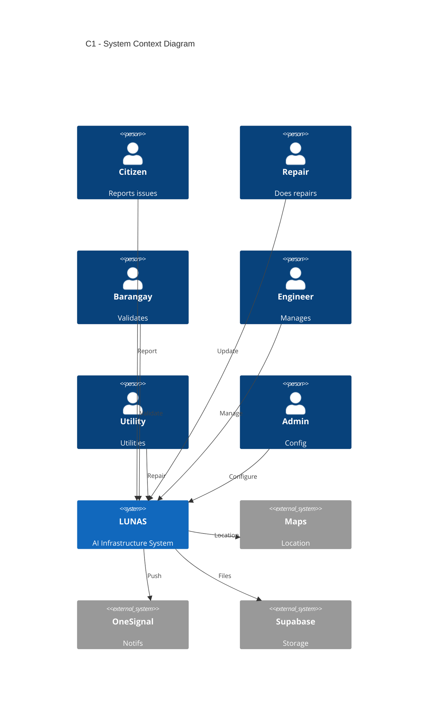
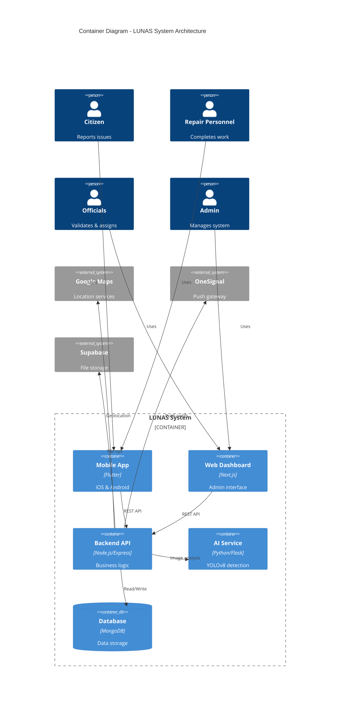
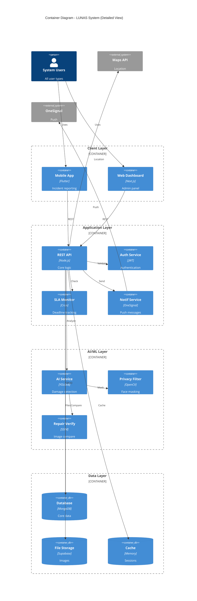

# LUNAS System - C4 Architecture Diagrams

## C1 - System Context Diagram

---

## C2 - Container Diagram

---

## Alternative C2 - Container Diagram (Detailed)

---

## How to Use These Diagrams

### Option 1: Mermaid Live Editor
1. Copy any diagram code above
2. Go to https://mermaid.live
3. Paste the code
4. Export as PNG/SVG

### Option 2: GitHub/GitLab
These diagrams will render automatically in Markdown files on GitHub/GitLab

### Option 3: VS Code
Install the "Markdown Preview Mermaid Support" extension

### Option 4: Documentation Tools
- Notion - supports Mermaid diagrams
- Confluence - via Mermaid plugin
- Docusaurus - native support

---

## Diagram Explanations

### C1 - System Context
Shows the LUNAS system as a single box with:
- **Actors:** 6 user types (Citizen, Repair Personnel, Barangay Official, City Engineer, Utility Provider, Admin)
- **External Systems:** Google Maps (location), OneSignal (notifications), Supabase (storage)
- **Relationships:** How users and systems interact via HTTPS/REST APIs

### C2 - Container Diagram
Shows internal structure:
- **Frontend:** Mobile app (Flutter) + Web dashboard (Next.js)
- **Backend:** Node.js/Express REST API
- **AI Service:** Python/Flask microservice with YOLOv8
- **Database:** MongoDB for structured data
- **Storage:** Supabase for images and files
- **External:** Google Maps, OneSignal

### Key Technologies
- **Mobile:** Flutter (iOS + Android)
- **Web:** Next.js/React
- **Backend:** Node.js + Express.js
- **AI/ML:** Python + Flask + YOLOv8 + PyTorch
- **Database:** MongoDB
- **Storage:** Supabase
- **Notifications:** OneSignal
- **Containerization:** Docker + Docker Compose

---

## System Features Highlighted

✅ **AI-Assisted Detection** - 85-90% accuracy on road damage  
✅ **Privacy Protection** - Automatic face/license plate masking  
✅ **Automated SLA** - Deadline tracking with escalation  
✅ **Role-Based Access** - 6 user types with specific permissions  
✅ **Real-Time Notifications** - Push notifications via OneSignal  
✅ **Geospatial Queries** - Location-based incident mapping  
✅ **Audit Logging** - Complete activity trail  
✅ **Repair Verification** - SSIM-based before/after comparison  

---

## Next Steps

For more detailed diagrams:
- **C3 - Component Diagram:** Break down each container into components
- **C4 - Code Diagram:** Class diagrams for specific features
- **Deployment Diagram:** Infrastructure and server architecture
- **Sequence Diagrams:** Workflow processes (report → repair → verify)

