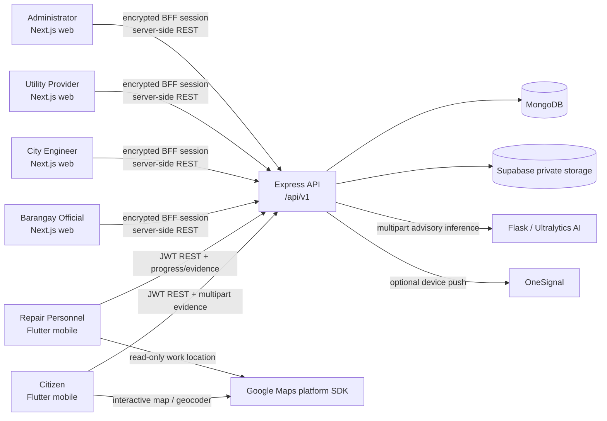
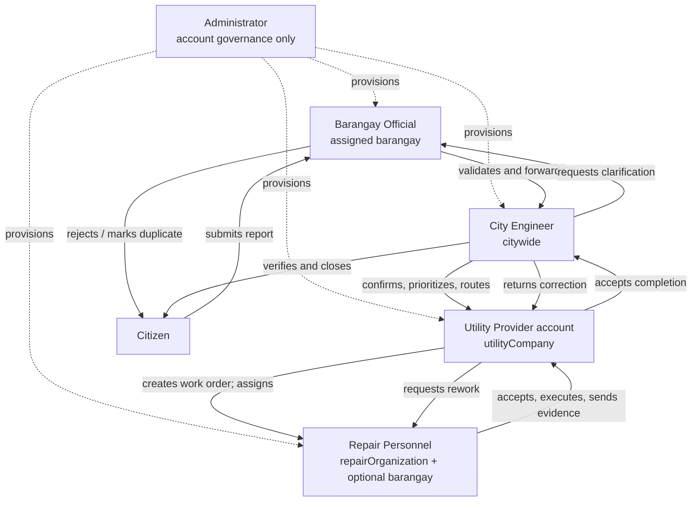
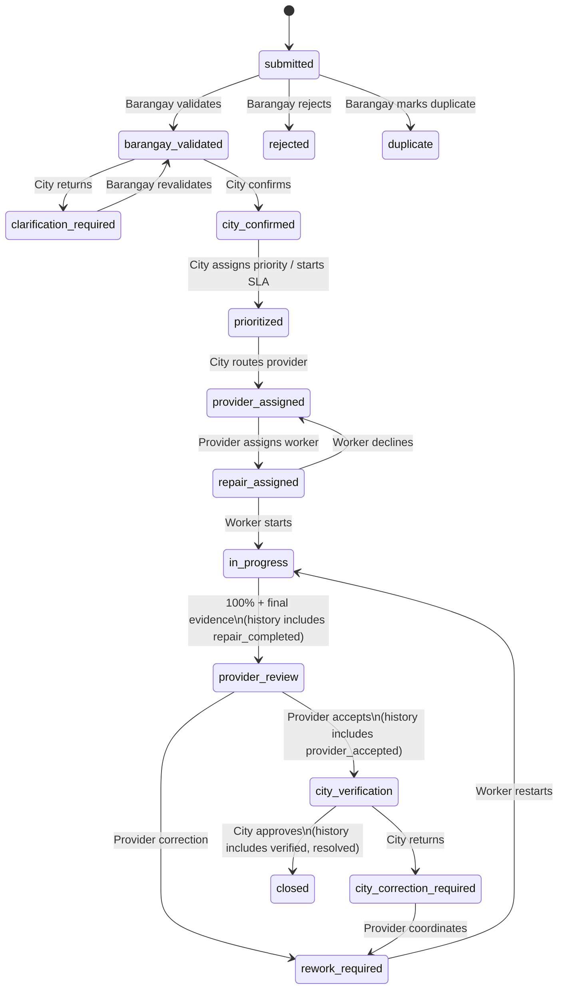
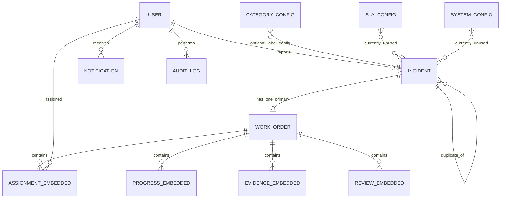

> Revision 9 scope update: backend-owned face and license-plate detection/redaction is implemented for new incident and repair evidence. The AI service returns normalized regions, the backend applies blur before storage, and the upload path fails closed when privacy processing is unavailable. Historical records retain their prior statuses. Non-privacy findings below retain their original audit context; consult the Revision 1-8 changes and reports for subsequent fixes.

# LUNAS Current Project Scope and Technical Audit

**Audit date:** 2026-10-01
**Evidence basis:** the current repository at this revision, inspected statically. Existing documentation was treated as secondary evidence.
**Runtime qualification:** no services, migrations, seeders, builds, linters, or test suites were run because the requested operation permits only this documentation file and those commands can create caches, logs, coverage data, or database state. Consequently, source-backed features are normally labelled **IMPLEMENTED BUT NOT RUNTIME VERIFIED**, not verified.
**Security note:** this report intentionally omits passwords, tokens, API keys, and credential values. It identifies unsafe credential handling without reproducing the values.

Status labels in this report have exactly these meanings:

| Label | Meaning |
|---|---|
| **IMPLEMENTED AND VERIFIED** | Demonstrated in the audited environment. No product feature received this label because runtime execution was out of scope. |
| **IMPLEMENTED BUT NOT RUNTIME VERIFIED** | A coherent source path exists, but this audit did not execute it. |
| **PARTIALLY IMPLEMENTED** | Some required layers or paths exist, but a material part is missing or contradictory. |
| **MOCK / UI ONLY** | The interface exists without the represented durable behavior. |
| **NOT IMPLEMENTED** | No effective implementation was found. |
| **OBSOLETE / LEGACY** | Source remains but is not part of the active route/runtime path. |

---

## 1. Executive Project Overview

LUNAS is a Dagupan City infrastructure-incident reporting and maintenance-coordination system. Citizens use a Flutter mobile application to submit geotagged, evidence-backed reports and follow their status. Barangay Officials, City Engineers, Utility Providers, and Administrators use a Next.js web workspace. Repair Personnel use the mobile application to accept assignments, start work, record staged progress, attach field evidence, and submit completion. An Express/MongoDB API is the authority for identity, jurisdiction and organization scoping, state changes, evidence metadata, notifications, SLA data, and audit records. A separate Flask/Ultralytics service can provide advisory computer-vision findings during citizen-evidence ingestion.

The implemented happy path is:

`Citizen submission -> Barangay validation -> City confirmation -> City priority -> City provider routing -> Utility Provider work-order creation -> repair assignment/acceptance -> repair progress and evidence -> Utility Provider review -> City final verification -> closed incident`.

The current code also supports Barangay rejection and duplicate decisions, a City-to-Barangay clarification loop, repair-personnel decline/reassignment, Utility Provider corrective work, and a City final-review return loop. It does **not** support incident deletion, citizen editing/cancellation after submission, automatic jurisdiction assignment, multiple work orders per incident, workflow cancellation, or automatic AI decisions. The canonical incident states are defined in `lunas_backend/src/services/incidentTransitionService.js:2-40`; the platform split is enforced by `lunas_mobile/lib/core/routes/app_router.dart:51-95` and `lunas_web/src/app/(protected)/layout.tsx:5-10`.

The repository is substantial but not release-ready. Critical blockers include the missing Utility Provider UI entry point for creating the first work order, a default Docker web-to-backend URL that resolves to the web container itself, a production session secret omitted from Compose, an in-progress reassignment state that the new repair assignee cannot accept, disabled-by-default SLA scheduling, and the other operational findings below. These findings are detailed in Sections 22-25.

### Purpose, users, and boundaries

- **Target users:** Dagupan residents, barangay validation staff, City Engineering, utility/maintenance organizations, their repair personnel, and system account administrators.
- **Geographic model:** addresses default to Dagupan City, Pangasinan; account provisioning recognizes 32 named Dagupan barangays (`lunas_backend/src/utils/validators.js:112-126`). Incident submission itself accepts any non-empty barangay string, so the geographic constraint is not fully enforced.
- **Categories:** `road`, `drainage`, `electrical`, `water`, `gas`, `streetlight`, and `other` (`lunas_backend/src/utils/incidentCategories.js:4-15`).
- **Operational boundary:** one routed Utility Provider organization and one durable primary work order per incident. The organization is a string, not an Organization entity; a repair assignee belongs to that same string-valued organization.
- **Human authority:** AI is advisory only. Barangay Officials decide initial validity; City Engineering sets priority and routing and performs final government verification; Utility Providers supervise repair execution.

## 2. Current Technology Stack

| Layer | Actual technologies | Important dependencies/configuration | Evidence |
|---|---|---|---|
| Mobile | Flutter, Dart `^3.11.3`, Material UI | Riverpod 3.3.1, GoRouter 17.1, `http`, secure storage, image picker, Google Maps, geolocator, geocoding | `lunas_mobile/pubspec.yaml`; `lunas_mobile/lib/main.dart` |
| Web | Next.js 16.2.1 App Router, React 19.2.4, TypeScript, Tailwind CSS 4 | Server Components/actions, encrypted HttpOnly BFF session cookie, Lucide icons, Playwright | `lunas_web/package.json`; `lunas_web/src/app`; `lunas_web/src/lib/auth/session-crypto.ts` |
| API | Node.js >=18, Express 4.18 | Mongoose 8, JWT, bcrypt, express-validator, Multer, Sharp, Helmet, CORS, compression, rate limiting, Winston, node-cron | `lunas_backend/package.json`; `lunas_backend/src/server.js:18-82` |
| Database | MongoDB 6 in Compose | Mongoose models and embedded subdocuments; GeoJSON `2dsphere` index | `docker-compose.yml`; `lunas_backend/src/models` |
| Evidence storage | Supabase Storage | Service-role server client; private by default; short-lived signed URLs; optional explicitly public bucket | `lunas_backend/src/services/storageService.js:11-87,183-234` |
| AI service | Python, Flask, Gunicorn, Ultralytics YOLO, PyTorch, Pillow/OpenCV | Category-specific `.pt` weights; CPU default in Compose | `lunas_ai/requirements.txt`; `lunas_ai/app.py`; `lunas_ai/config.yaml` |
| Push | OneSignal | Durable MongoDB notification first, push when credentials and user device token exist | `lunas_backend/src/services/notificationService.js:80-154` |
| Maps | Google Maps SDK on mobile; external Google Maps links on web | Device location and platform geocoder; build-time platform keys | `lunas_mobile/lib/features/maps`; `lunas_web/src/components/validation/validation-review.tsx:96-117` |
| Deployment | Docker Compose | MongoDB, backend, web, AI, optional mongo-express; mobile is built/deployed separately | `docker-compose.yml`; component Dockerfiles |
| Tests | Jest/Supertest, Flutter test, Playwright | 29 backend test files, 6 mobile test files, 2 web E2E specs; no executable AI pytest suite found | file inventory under `lunas_backend/src/**/*.test.js`, `lunas_mobile/test`, `lunas_web/tests` |

## 3. Repository Architecture

| Path | Responsibility | Active assessment |
|---|---|---|
| `lunas_mobile/` | Citizen and Repair Personnel Flutter client | Active; several unrouted legacy screens also remain |
| `lunas_web/` | Official/admin Next.js workspace and backend-for-frontend session layer | Active; citizen/repair roles are intentionally refused |
| `lunas_backend/` | REST API, models, workflow controllers/services, storage/AI/push integrations, seed/migration scripts | Active and authoritative |
| `lunas_ai/` | Category-aware image-detection microservice and checked-in model weights | Active integration path; model execution not verified |
| `docker-compose.yml` | Local/container topology | Present but default web configuration is internally inconsistent |
| `README.md` | Setup and demo instructions | Current in many areas, but overstates UI-only demo completeness and contains a shared demo credential |
| `LUNAS_PROJECT_SCOPE.md` | Prior/current intended scope | Mostly aligned with revised workflow, but it is not proof of runtime behavior |
| `API_ENDPOINTS.md` | API reference | Broadly aligned; misses several practical scoping/UI defects described here |

Communication is JSON over REST except multipart evidence. The web browser does not retain raw tokens in JavaScript: a server action logs in and stores access/refresh tokens inside an AES-256-GCM encrypted HttpOnly cookie (`lunas_web/src/lib/auth/session-crypto.ts:54-127`). Flutter stores tokens with `flutter_secure_storage` and retries one failed authenticated request after rotating the refresh token (`lunas_mobile/lib/core/network/api_client.dart:184-248`).

No shared generated API client, message broker, transaction coordinator, or outbox exists. Controllers make sequential MongoDB, notification, audit, storage, and cross-service calls. That makes partial success possible after the primary database mutation.

## 4. Current User Roles

The complete role enumeration is `citizen`, `repair_personnel`, `barangay_official`, `city_engineer`, `utility_provider`, and `admin` (`lunas_backend/src/utils/accountPolicy.js:1-5`).

| Identifier / display name | Platform and scope | Responsibilities and dashboard | Accessible UI / navigation | Explicitly prohibited or absent | Account lifecycle | Status |
|---|---|---|---|---|---|---|
| `citizen` / Citizen | Mobile; own incidents and own notifications only | Submit and track reports; citizen dashboard summarizes own recent reports | Onboarding/auth, `/citizen`, report wizard/list/detail/timeline, map picker, notifications, read-only profile | Cannot validate, prioritize, route, create/manage work orders, see others' reports, edit/cancel a submitted report, or use web workspace | Public mobile registration, email OTP verification, then active account | **IMPLEMENTED BUT NOT RUNTIME VERIFIED** |
| `repair_personnel` / Repair Personnel | Mobile; current pending/accepted assignments in own `repairOrganization`, further limited by optional assigned barangay | Dashboard summary; accept/decline, start, report 25/50/75/100%, upload evidence | `/repair`, work-order list/detail/start/progress/evidence/location, read-only account profile | Cannot validate incidents, choose priority/provider, assign workers, provider-review, city-verify, access web, or see completed/unassigned/other-organization orders | Admin provisions after offline approval; user activates through email link | **IMPLEMENTED BUT NOT RUNTIME VERIFIED** with notification and reassignment gaps |
| `barangay_official` / Barangay Official | Web; exact assigned barangay, using confirmed jurisdiction or submitted barangay fallback | Validation dashboard/queue; validate, reject, mark duplicate; handle returned clarification | Dashboard, Pending validation, Notifications, Profile, Help | Cannot set priority, route providers, manage work orders/accounts, or final-verify | Admin provisions and assigns a recognized barangay; activation required | **IMPLEMENTED BUT NOT RUNTIME VERIFIED** |
| `city_engineer` / City Engineer | Web; citywide incident/work-order visibility | Confirm/return reports, set priority/SLA, route provider, monitor all work, final verify/return | Dashboard, Pending validation, Work orders, SLA monitor, Notifications, Profile, Help | Cannot perform Barangay decision, create provider's work order, assign repair personnel, or administer accounts | Admin provisions; city scope is implicit, activation required | **IMPLEMENTED BUT NOT RUNTIME VERIFIED** |
| `utility_provider` / Utility Provider | Web/API; incidents and work orders whose organization string exactly matches `utilityCompany` | Provider dashboard; create/manage work order, assign/reassign repair personnel, review completion, coordinate correction | Dashboard, Work orders, SLA monitor, Notifications, Profile, Help | Cannot validate, prioritize, route, final city-verify, manage accounts; **cannot reach routed incidents in web UI to create their initial work order** | Admin provisions with `utilityCompany`; activation required | **PARTIALLY IMPLEMENTED** |
| `admin` / Administrator | Web; authorized-account and audit domains, not incident operations | Authorized-account console and audit trail; no incident dashboard | Authorized accounts, Audit trail, Notifications, Profile, Help; `/dashboard` redirects to `/admin/users` | Backend incident/work-order APIs do not grant Admin access; cannot self-change account; additional Admin provisioning requires allowlist | Initial admin is an offline/deployment bootstrap; later accounts require an allowed Admin and approval metadata | **IMPLEMENTED BUT NOT RUNTIME VERIFIED** |

Backend record scopes are query-level, not merely UI hiding: incident scopes are in `lunas_backend/src/services/jurisdictionService.js:39-71`; work-order scopes and eligibility are in `lunas_backend/src/services/workOrderService.js:55-97`. One exception is `/incidents/nearby`: it authorizes Repair Personnel at the route, but their computed incident scope is `{_id:null}`, so it returns no repair incidents (`incidentRoutes.js:51-57` versus `jurisdictionService.js:70-71`).

## 5. Platform and Permission Matrix

Legend: **R** read; **C/U** create/update; **D** decision; **M** manage; **Own** own records only; **Org** organization-scoped; **Barangay** jurisdiction-scoped; **All** citywide; `—` denied/no active UI.

| Capability | Citizen | Repair Personnel | Barangay Official | City Engineer | Utility Provider | Admin |
|---|---:|---:|---:|---:|---:|---:|
| Platform workspace | Mobile | Mobile | Web | Web | Web | Web |
| Public self-registration | Yes | — | — | — | — | — |
| Own profile / password / logout API | Own | Own | Own | Own | Own | Own |
| Submit incident | C, Own | — | — | — | — | — |
| View incidents | Own | — | Barangay | All | Org/routed | — |
| Initial validation/reject/duplicate | — | — | D, Barangay | — | — | — |
| Confirm/clarify/priority/jurisdiction/route | — | — | — | D, All | — | — |
| Create work order | — | — | — | — | C, Org, API/server action only | — |
| View work orders | — | Assigned | — | All | Org | — |
| Assign/reassign personnel | — | — | — | — | M, Org | — |
| Accept/decline/start/progress/evidence | — | C/U, Assigned | — | — | — | — |
| Provider completion review/correction coordination | — | — | — | — | D, Org | — |
| Final verification/closure | — | — | — | D, All | — | — |
| SLA monitor | Own incident projection | Assigned work order | Dashboard context only | All | Org | — |
| Notifications UI | Own, mobile | **No active mobile route** | Own, web | Own, web | Own, web | Own, web |
| Authorized-account administration | — | — | — | — | — | M |
| Audit-log access | — | — | — | — | — | R |

Web permission definitions are at `lunas_web/src/lib/permissions.ts:3-35`; sidebar filtering is at `lunas_web/src/components/layout/navigation-config.ts:22-50`. Backend `protect` validates access-token type, account state, and token version, while `authorize` checks exact roles (`lunas_backend/src/middleware/auth.js:7-107`). Hidden UI is therefore backed by controller/route authorization for the core actions, although several unused middleware functions at `auth.js:110-205` are legacy rather than part of the actual enforcement chain.

## 6. Organizational Relationships

Operational ownership is deliberately separated:

1. The Citizen is the reporter and evidence source, not a validator.
2. The Barangay Official is the first decision authority only for the exact assigned barangay. The Barangay is no longer an actor after forwarding, except when City Engineering requests clarification.
3. City Engineering is the citywide government authority: it confirms jurisdiction, sets priority (which starts SLA), chooses a Utility Provider organization, and performs final closure.
4. The Utility Provider owns work coordination for its exact `utilityCompany`: it creates the single work order, selects eligible same-organization Repair Personnel, and approves or returns completed field work.
5. Repair Personnel are operational workers. Eligibility requires active status, `availability === available`, exact organization match, and—if set—matching barangay. Stored `expertise` is returned to the UI but not used for eligibility (`workOrderService.js:84-97`).
6. Admin governs identities and audit visibility but is intentionally outside incident/work-order authority.

Organizations and barangays are not first-class database entities. Organization ownership is string equality across `User.utilityCompany`, `User.repairOrganization`, `Incident.routing.responsibleOrganization`, and `WorkOrder.responsibleOrganization`. This makes spelling/case and renaming operationally significant. Barangay account provisioning validates a static list, while incident and jurisdiction inputs do not, allowing a typo to create an unreachable Barangay queue.

## 7. Complete Incident Lifecycle

### A. Main implemented workflow

| # | Owner / platform | Trigger, required input, and UI | Endpoint -> controller/service | Database transition and next owner | Notification / history / audit | Principal failures |
|---:|---|---|---|---|---|---|
| 1 | Citizen / mobile | `/reports/new` -> evidence/category/location pickers -> `/reports/review`: 1 image, category, description >=10 chars, GPS/manual pin, manually typed barangay, privacy acknowledgement | `POST /api/v1/incidents` -> `createIncident`; upload, validation, duplicate, evidence/AI/storage services | Creates Incident `submitted`, evidence metadata, advisory duplicate candidates; next Barangay | Citizen submission notification; `submitted` statusHistory; `incident_created`, file and AI audit events | Invalid form/file; quality/decode failure; missing privacy acknowledgement; Supabase failure; DB failure cleans uploaded objects |
| 2 | Barangay Official / web | `/validation-routing/:id`; confirm jurisdiction and optional notes; confirmation dialog | `POST /incidents/:id/validate` -> `validateIncident` | Atomic `submitted -> barangay_validated`; next City | Citizen notified; all active City Engineers notified; history and `incident_validated` audit | Wrong barangay, stale status, missing jurisdiction, 409 concurrent decision |
| 3 | City Engineer / web | `/validation-routing/:id`; confirm report and jurisdiction | `POST /incidents/:id/confirm` -> `confirmIncident` | `barangay_validated -> city_confirmed`; City remains owner | Citizen status notification; history/audit | Wrong state, stale update, invalid text |
| 4 | City Engineer / web | Same review page; select critical/high/medium/low | `PATCH /incidents/:id/priority` -> `updateIncidentPriority`; `initializeIncidentSLA` | `city_confirmed -> prioritized`; sets priority and SLA start/deadline | History/audit; no separate citizen priority notification found | Wrong state, invalid priority, concurrent update |
| 5 | City Engineer / web | Same review page; choose organization returned by `/users/utility-providers`, optional reason | `POST /incidents/:id/route` -> `routeIncident` | `prioritized -> provider_assigned`; sets utility-only routing and a representative provider account; next Utility Provider | All active provider accounts in organization notified; routing/status history and audit | Organization has no active matching provider; state conflict; arbitrary API string not in returned list |
| 6 | Utility Provider / **API only in current UI** | Incident ID plus optional instructions; server action exists but no reachable component invokes it | `POST /incidents/:id/work-orders` -> `createWorkOrder` | Creates one unique WorkOrder `pending/unassigned`; links it to Incident, which remains `provider_assigned`; next Provider | Work-order/incident history and audit | Provider cannot reach action in web UI; wrong org/state; duplicate work order; split-write risk |
| 7 | Utility Provider / web | `/work-orders/:id`; choose eligible worker | `POST /work-orders/:id/assign` -> `assignWorkOrder` | WorkOrder assignment `unassigned/declined -> pending`; Incident `provider_assigned -> repair_assigned`; next Repair Personnel | Worker notified; assignment/work-order/incident history and audit | No eligible worker, wrong org, active assignment, stale version |
| 8 | Repair Personnel / mobile | `/repair/work-orders/:id`; accept assignment | `POST /work-orders/:id/accept` -> `acceptWorkOrder` | WorkOrder `pending -> accepted`, assignment `pending -> accepted`; Incident stays `repair_assigned` | Assigning provider notified; history/audit | Not current assignee; state/version conflict |
| 9 | Repair Personnel / mobile | `/repair/work-orders/:id/start`; confirm start; client may send current location | `POST /work-orders/:id/start` -> `startWorkOrder` | WorkOrder `accepted/rework_required -> in_progress`; Incident `repair_assigned/rework_required -> in_progress` | Provider notified; history/audit | Body location is ignored by this endpoint; wrong assignment/state/version |
| 10 | Repair Personnel / mobile | `/repair/work-orders/:id/progress` and `/evidence`; submit exact 25%, 50%, 75% stages, optional notes/location/evidence | `POST /work-orders/:id/progress` -> `updateProgress` | WorkOrder remains `in_progress`; embedded progress/evidence; Incident remains `in_progress` | Provider progress notification; work-order/incident history and audits | Stage/percent mismatch, regression/repeat, invalid location/evidence, storage/version failure |
| 11 | Repair Personnel / mobile | Progress screen; submit 100%, meaningful note, mandatory final post-maintenance evidence | Same progress endpoint/controller | WorkOrder `in_progress -> completed`; Incident atomically records `repair_completed`, then `provider_review` and persists `provider_review`; next Provider | Provider notified; evidence/progress audits and histories; worker becomes available | Missing final evidence/note; upload/state/version failure |
| 12 | Utility Provider / web | `/work-orders/:id`; accept completion, optional note | `POST /work-orders/:id/provider-review` -> `reviewCompletedWork` | WorkOrder `completed -> provider_accepted`; Incident records `provider_accepted`, `city_verification`, persists `city_verification`; next City | All City Engineers notified; review/history/audit | Wrong org/state; no assignee; concurrent update |
| 13 | City Engineer / web | `/work-orders/:id`; approve final repair, optional note | `POST /work-orders/:id/final-review` -> `finalReviewWorkOrder` | WorkOrder `provider_accepted -> verified`, SLA `met`; Incident records `verified -> resolved -> closed` in one request | Citizen resolved notification; review/status histories and closure audit | Wrong state, stale version, downstream notification/audit failure after mutation |

Controller function locations are `lunas_backend/src/controllers/incidentController.js:306,828,895,1097,1192` and `lunas_backend/src/controllers/workOrderController.js:307,493-629,631-835,861-1009,1143-1291`. Route authorization is explicit in `lunas_backend/src/routes/incidentRoutes.js:51-180` and `workOrderRoutes.js:43-91`.

### B. Alternate, rejection, and corrective paths

| Path | Actual behavior | End/return point | Status |
|---|---|---|---|
| Possible duplicate hint | Same category + within configurable 72h/100m defaults; at most five scored candidates. It never changes status automatically. | Barangay decides later | **IMPLEMENTED BUT NOT RUNTIME VERIFIED**; `duplicateDetectionService.js:16-67` |
| Barangay rejection | Reason required; `submitted -> rejected`; citizen notified; terminal in current state machine | Terminal | **IMPLEMENTED BUT NOT RUNTIME VERIFIED** |
| Barangay duplicate decision | Canonical Incident ObjectId and reason required; `submitted -> duplicate`; citizen notified | Terminal; no merge behavior | **IMPLEMENTED BUT NOT RUNTIME VERIFIED** |
| City clarification | Reason required; `barangay_validated -> clarification_required`; Citizen is notified, but there is no citizen response/edit endpoint. Barangay can revalidate the same record, `clarification_required -> barangay_validated`. | City confirmation again | **PARTIALLY IMPLEMENTED** |
| Repair decline | Pending assignee supplies reason; assignment is ended, worker available, WorkOrder stays `pending` or `rework_required`; Incident returns to `provider_assigned` or remains `rework_required`. | Provider assigns again | **IMPLEMENTED BUT NOT RUNTIME VERIFIED** |
| Provider reassignment | Requires active assignment, eligible new worker, and reason. Accepted-before-start orders return to `pending`; rework stays rework. | New assignee accept/start | **PARTIALLY IMPLEMENTED** because in-progress reassignment remains `in_progress/pending`, but accept permits only `pending` or `rework_required` (`workOrderController.js:514-519,631-636`) |
| Provider correction | Provider rejects a completed repair with reason/instructions; WorkOrder and Incident -> `rework_required`; existing worker becomes assigned and can start again. At 100% corrective resubmission, validation internally uses a 75% baseline. | Repair -> Provider review | **IMPLEMENTED BUT NOT RUNTIME VERIFIED** |
| City correction | City returns `provider_accepted` work; WorkOrder/Incident -> `city_correction_required`; Provider must call coordinate-correction, moving both -> `rework_required`, then worker restarts. | Repair -> Provider -> City | **IMPLEMENTED BUT NOT RUNTIME VERIFIED** |
| Cancellation/deletion | No route. A dormant `deleteIncident` controller exists, but routes intentionally preserve rejection/duplicate/closure history. No work-order cancel state exists. | Not available | **NOT IMPLEMENTED** (`incidentRoutes.js:183-184`) |

Important implementation nuance: several conceptual incident steps are appended together. `repair_completed` and `provider_accepted` are visible in history but do not remain queryable as current states; similarly, final approval writes `verified`, `resolved`, and `closed` in one operation (`workOrderController.js:954-967,1163-1169,1272-1277`).

## 8. Incident and Work-Order State Machines

### Incident state transitions

| From | Allowed next state(s) | Actor/action | Persisted as a current state? |
|---|---|---|---|
| `submitted` | `barangay_validated`, `rejected`, `duplicate` | Barangay decision | Yes |
| `barangay_validated` | `city_confirmed`, `clarification_required` | City confirm/return | Yes |
| `clarification_required` | `barangay_validated` | Barangay revalidation | Yes |
| `city_confirmed` | `prioritized` | City priority | Yes |
| `prioritized` | `provider_assigned` | City routing | Yes |
| `provider_assigned` | `repair_assigned` | Provider assignment | Yes |
| `repair_assigned` | `provider_assigned`, `in_progress` | Worker decline or start | Yes |
| `in_progress` | `repair_completed` | Worker reaches 100% | History only in normal completion; immediately advances |
| `repair_completed` | `provider_review` | Completion handoff | `provider_review` persists |
| `provider_review` | `rework_required`, `provider_accepted` | Provider review | Rework persists; accepted immediately advances |
| `rework_required` | `in_progress` | Worker restarts correction | Yes |
| `provider_accepted` | `city_verification` | Provider-to-City handoff | `city_verification` persists |
| `city_verification` | `city_correction_required`, `verified` | City final decision | Correction persists; approval immediately advances |
| `city_correction_required` | `rework_required` | Provider coordinates correction | Yes |
| `verified` | `resolved` | Atomic City approval sequence | History only |
| `resolved` | `closed` | Atomic City approval sequence | `closed` persists |
| `rejected`, `duplicate`, `closed` | none | Terminal | Yes |

Source of truth: `lunas_backend/src/services/incidentTransitionService.js:2-40`.

### Work-order states and orthogonal assignment state

| WorkOrder state | Assignment state | Entry / valid action | Next state(s) |
|---|---|---|---|
| `pending` | `unassigned` or `declined` | New order or prior decline; Provider assigns | `pending/pending` |
| `pending` | `pending` | Worker accepts or declines | `accepted/accepted` or `pending/declined` |
| `accepted` | `accepted` | Worker starts; Provider may reassign | `in_progress/accepted`; or `pending/pending` |
| `in_progress` | `accepted` | Worker adds evidence and 25/50/75/100 progress | `in_progress` or `completed` |
| `completed` | `accepted` | Provider accepts or requests correction | `provider_accepted` or `rework_required` |
| `rework_required` | usually `accepted`; may be `pending` after reassignment | Worker starts correction; pending new worker accepts/declines | `in_progress`; or same state with accepted/declined assignment |
| `provider_accepted` | `accepted` | City approves or returns | `verified` or `city_correction_required` |
| `city_correction_required` | `accepted` | Provider sends correction instructions | `rework_required` |
| `verified` | `accepted` | Terminal | none |

Progress is constrained to `0/assigned`, `25/site_preparation`, `50/main_repair`, `75/finishing`, and `100/ready_for_completion` (`workOrderService.js:10-20,101-123`). Work-order status and assignment state are separate fields (`WorkOrder.js:132-169`). Optimistic `version` predicates are used for controlled mutations.

## 9. Individual User Flows

### Citizen — mobile

1. **Onboard/login/register.** `/onboarding` links to `/login` or `/register`. Registration collects identity, Philippine phone number, email, and password; the API always assigns `citizen`. Delivery failure prevents a new registration from silently succeeding.
2. **Verify registration.** `/register/verify` submits the email, signed challenge token, and OTP, supports resend cooldown, and activates the account after a valid code. Exhausted/expired attempts remain an error state.
3. **Home.** `/citizen` loads the user's reports; it shows loading, error/retry, empty, and recent-report states. “City Insights” is explicitly unavailable; “View Map” opens a location picker, not a city incident map (`citizen_dashboard_screen.dart:78-153`).
4. **Create report.** `/reports/new` launches camera/gallery evidence, category selection, interactive map/GPS location, description, and a manually entered barangay. `/reports/review` requires explicit privacy acknowledgement and submits once; API validation/storage errors remain on the review screen.
5. **Track reports.** `/reports` calls `GET /incidents/my`; detail and timeline call scoped detail/history endpoints. The citizen sees evidence/AI availability, status history, routing/repair summaries returned by the server, but cannot mutate the report.
6. **Notifications.** `/notifications` loads own records, marks one or all read, and opens `/notifications/details`. A linked Incident opens its citizen detail. No mobile delete action is wired even though the API supports deletion.
7. **Profile/logout.** `/profile` is read-only and confirms sign-out. An API-backed update service and older edit-profile screen exist but are not routed, so mobile profile editing is not currently reachable.
8. **End.** The journey ends at rejection, duplicate, or City-verified closure. Clarification is visible/notified, but the Citizen has no response/edit action.

### Repair Personnel — mobile

1. **Provision/activate/login.** An Admin creates the account with organization and optional barangay; the worker follows the web activation link, then logs in on mobile. Other privileged roles are redirected to `/role-unavailable`.
2. **Dashboard.** `/repair` calls `/dashboard/work-orders-summary` and links to assigned tasks. Home/Tasks/Profile bottom navigation is implemented (`repair_widgets.dart:133-169`).
3. **Review assignments.** `/repair/work-orders` and `/:id` load only server-scoped current assignments, showing Incident, location, citizen and repair evidence, progress, assignment history, and SLA.
4. **Accept/decline.** Detail offers accept or a decline dialog with required reason. A success refreshes or returns to the list; 409/stale errors are shown without pretending success.
5. **Start.** `/:id/start` confirms the order and can request location, but the backend ignores start-location input. It moves an accepted/rework order to in-progress.
6. **Work.** `/:id/progress` submits controlled stages and optional current location. `/:id/evidence` uploads one camera/gallery image at a time while in-progress. `/:id/location` is a read-only map of the citizen pin and does not track the worker in the background.
7. **Complete.** 100% requires a meaningful note and new final evidence. It hands work to Utility Provider review; it does not close the Incident.
8. **Correction/end.** Provider or City returns cause rework; the worker restarts and submits 100% again. Final City verification removes the order from the worker's active scope. Repair users have no active notification center route.

### Barangay Official — web

1. **Provision/activate/login.** Admin supplies a recognized barangay and approval record; user follows activation link. Web login requires Turnstile unless an explicit nonproduction bypass is enabled.
2. **Dashboard/queue.** `/dashboard` and `/validation-routing` load a barangay-scoped summary and `submitted`/`clarification_required` records.
3. **Review.** `/validation-routing/:id` shows citizen evidence, AI overlays/advisory status, coordinates with external map link, possible duplicates, jurisdiction, and immutable history.
4. **Decide.** Confirmation dialog submits validate, reject with reason, or duplicate with canonical report/reason. Backend query scope and conditional status update protect against URL tampering and concurrent decisions.
5. **Clarification.** A City-returned item reappears; the official can revalidate with notes. There is no separate structured clarification response or citizen amendment.
6. **Notifications/profile/logout.** Web notification center and profile/password screens are API-backed; help is informational only. Workflow ends when forwarded/rejected/duplicated.

### City Engineer — web

1. **Provision/activate/login.** Admin provisions the citywide account; activation and Turnstile web login apply.
2. **Dashboard.** Shows pending City review, provider-accepted final queue, active repairs, approaching/overdue counts, and completed-awaiting-provider-review from live APIs (`dashboard.server.ts:141-176`).
3. **Initial review.** In `/validation-routing/:id`, confirm the Barangay-validated report or request clarification with a reason.
4. **Prioritize.** Select one of four priorities; the server starts the Incident SLA at that moment.
5. **Route.** Select an active Utility Provider organization; server records the handoff and notifies provider accounts.
6. **Monitor.** `/work-orders` and `/sla` expose citywide work orders and calculated deadline state; location is an external Google Maps link, not an embedded web map.
7. **Final review.** On `provider_accepted`, approve to verify/resolve/close or return with reason to the provider. Confirmation and server version checks prevent stale decisions.
8. **End.** Approval notifies the Citizen. Returns end only after another Provider/Repair corrective cycle.

### Utility Provider — web

1. **Provision/activate/login.** Admin sets `utilityCompany`; account activation and Turnstile web login apply.
2. **Dashboard.** Live organization-scoped work-order counts and queue load. It does not list newly routed incidents that lack work orders.
3. **Create work order.** Backend route and Next server action exist, but no accessible provider page renders that action. The provider therefore cannot perform this required step through the current web UX.
4. **Assign/manage.** Once a work order exists (for example through a direct authenticated API call), `/work-orders/:id` lists eligible personnel and supports assignment/reassignment with required reason.
5. **Supervise.** Dashboard/list/detail expose progress, evidence, assignment history, and SLA. Provider receives in-app notifications from worker actions.
6. **Review completion.** Accept and forward to City, or request corrective work with reason/instructions.
7. **Coordinate City return.** A City-returned order requires an explicit provider coordination action before the worker can restart.
8. **End.** Provider waits for City verification or repeats correction. In-progress reassignment is currently deadlocked at new-worker acceptance.

### Administrator — web

1. **Bootstrap/login.** The first Admin must be created through a controlled offline/deployment process. Login goes to `/admin/users`, not an incident dashboard.
2. **Browse accounts.** Search/filter/paginate authorized accounts and open details.
3. **Provision.** Create Repair, Barangay, City, Utility, or—only if actor ID is in `AUTHORIZED_ADMIN_PROVISIONER_IDS`—another Admin. Approval authority/reference and role-specific scope are required; activation delivery is an external dependency.
4. **Lifecycle changes.** Update approved fields, resend activation, activate/suspend/deactivate, or archive. Delete compatibility routes archive rather than erase. Self-management and unauthorized Admin creation are blocked server-side.
5. **Audit.** `/admin/audit` reads and filters server audit records. It is an operational log, not cryptographically immutable evidence.
6. **End.** Admin can update own profile/password/logout, but has no Incident/WorkOrder authority.

## 10. Complete Mobile UX Inventory

Active routing is authoritative at `lunas_mobile/lib/core/routes/app_router.dart:46-266`.

| Route / screen | Role and entry | Purpose / primary actions | API connection | Status |
|---|---|---|---|---|
| `/splash` `AppSplashScreen` | All | Restore session, retry login | `GET /auth/me` through auth controller | **IMPLEMENTED BUT NOT RUNTIME VERIFIED** |
| `/onboarding` `OnboardingScreen` | Public | Login/register entry; feature cards show unavailable snackbar | None | **PARTIALLY IMPLEMENTED** |
| `/login` `CitizenLoginScreen` | Public | Email/password login for Citizen or Repair role | `POST /auth/login`; no platform/device token sent | **PARTIALLY IMPLEMENTED** |
| `/register` | Public Citizen | Citizen identity/account form | `POST /auth/register` | **IMPLEMENTED BUT NOT RUNTIME VERIFIED** |
| `/register/verify` | Pending Citizen | OTP entry/resend | `POST /auth/register/verify`, `/resend` | **IMPLEMENTED BUT NOT RUNTIME VERIFIED** |
| `/forgot-password`, `/reset-password` | Public | Request reset and apply token/new password | `POST /auth/forgot-password`, `/reset-password` | **IMPLEMENTED BUT NOT RUNTIME VERIFIED** |
| `/role-unavailable` | Authenticated web-only roles | Explains mobile workspace restriction | Local auth state | **IMPLEMENTED BUT NOT RUNTIME VERIFIED** |
| `/citizen` | Citizen Home tab | Own recent reports, new report CTA, map picker, unavailable City Insights | `GET /incidents/my` | **PARTIALLY IMPLEMENTED** |
| `/reports` | Citizen Reports tab | Paginated-looking own list (service currently requests first page/limit only), filter/display, open detail | `GET /incidents/my` | **IMPLEMENTED BUT NOT RUNTIME VERIFIED** |
| `/reports/new` | Citizen CTA | Assemble one evidence image, category, description, pin, manually typed barangay | Component navigation only | **IMPLEMENTED BUT NOT RUNTIME VERIFIED** |
| `/reports/evidence` | Citizen wizard | Camera/gallery, local type/size checks and preview | No AI call; ImagePicker | **IMPLEMENTED BUT NOT RUNTIME VERIFIED** |
| `/reports/categories` | Citizen wizard | Server categories with fallback/error UI | `GET /categories` | **IMPLEMENTED BUT NOT RUNTIME VERIFIED** |
| `/reports/location` | Citizen Map tab/wizard | GPS permission, current location, tap pin, reverse-geocoded address, confirmation in picker mode | Device Google Maps/geocoder, no backend | **IMPLEMENTED BUT NOT RUNTIME VERIFIED** |
| `/reports/review` | Citizen wizard | Summary, privacy acknowledgement, submit | Multipart `POST /incidents` | **IMPLEMENTED BUT NOT RUNTIME VERIFIED** |
| `/reports/submitted` | Citizen post-submit | Confirmation, open report/home | Uses in-memory returned report | **IMPLEMENTED BUT NOT RUNTIME VERIFIED** |
| `/reports/drafts` | Citizen indirect route | Always-honest empty state; no save path or persistence | None | **MOCK / UI ONLY** (`my_drafts_screen.dart:18-21`) |
| `/reports/:id` | Citizen | Scoped detail, evidence, AI availability, current status, route/repair summary | `GET /incidents/:id`; attempts history | **IMPLEMENTED BUT NOT RUNTIME VERIFIED** |
| `/reports/:id/timeline` | Citizen | Status-history timeline with loading/error | `GET /incidents/:id`, `/history` | **IMPLEMENTED BUT NOT RUNTIME VERIFIED** |
| `/notifications`, `/notifications/details` | Citizen Alerts tab | List, mark read/all read, show linked report | Notification GET/PUT endpoints | **PARTIALLY IMPLEMENTED**: no delete; report-only deep link |
| `/profile` | Citizen Profile tab | View identity and confirm logout | Logout; no reachable update | **PARTIALLY IMPLEMENTED** |
| `/repair` | Repair Home tab | Work summary and task shortcuts | `GET /dashboard/work-orders-summary` | **IMPLEMENTED BUT NOT RUNTIME VERIFIED** |
| `/repair/work-orders` | Repair Tasks tab | Own active assignment list/filter | `GET /work-orders/my` | **IMPLEMENTED BUT NOT RUNTIME VERIFIED** |
| `/repair/work-orders/:id` | Repair | Full task/evidence/progress/SLA; accept/decline and action links | Work-order detail, accept/decline | **IMPLEMENTED BUT NOT RUNTIME VERIFIED** |
| `/:id/start` under repair path | Repair | Confirm start; optional client location | `POST /work-orders/:id/start` | **PARTIALLY IMPLEMENTED**: location discarded by backend |
| `/:id/progress` | Repair | Controlled next progress stage, notes, optional location, final image | Multipart/JSON `POST .../progress` | **IMPLEMENTED BUT NOT RUNTIME VERIFIED** |
| `/:id/evidence` | Repair | Select and upload a field image/caption | Multipart `POST .../evidence` | **IMPLEMENTED BUT NOT RUNTIME VERIFIED** |
| `/:id/location` | Repair | Read-only Google map of Incident pin | Work-order detail + map SDK | **IMPLEMENTED BUT NOT RUNTIME VERIFIED** |
| `/repair/profile` | Repair Profile tab | Read-only organization/account and logout | Logout | **PARTIALLY IMPLEMENTED** |

Citizen bottom navigation is Home, Reports, Map, Alerts, Profile (`citizen_bottom_navigation.dart:7-38`). The report screen's final button says “Continue to Location” even though it proceeds to review after location was already selected (`new_citizen_report_screen.dart:49-80,251-255`). It accepts one image while the API allows five. The UI caps descriptions at 500 characters while the backend allows 2,000.

Mobile error handling converts API failures to user-safe messages, clears a rejected session on 401, and supports one refresh/retry (`api_client.dart:184-248`). It has no offline submission queue, background upload, draft persistence, push SDK initialization, or separate device-token registration endpoint. Because login sends neither `platform` nor `deviceToken` (`auth_service.dart:17-26`), OneSignal push cannot be enabled by this client as written.

## 11. Complete Web UX Inventory

All protected pages first require a valid web workspace, excluding Citizen and Repair Personnel (`lunas_web/src/app/(protected)/layout.tsx:5-10`). Page guards then require permissions. The application shell has a desktop sidebar and mobile drawer; navigation is filtered by `navigation-config.ts`. An offline indicator exists, but there is no offline mutation queue.

| Route / page | Roles | Actual behavior | Status |
|---|---|---|---|
| `/login` | Public | Turnstile-enabled login server action; redirects by role | **IMPLEMENTED BUT NOT RUNTIME VERIFIED** |
| `/activate-account` | Provisioned users | Consumes activation token and new password | **IMPLEMENTED BUT NOT RUNTIME VERIFIED** |
| `/forgot-password`, `/reset-password`, `/session-expired` | Public/session | Recovery and safe session-expiry handling | **IMPLEMENTED BUT NOT RUNTIME VERIFIED** |
| `/verify-account` | Public | Explicit “not available yet” placeholder; not mobile registration OTP | **MOCK / UI ONLY** |
| `/dashboard` | Barangay, City, Provider | Live API metrics/records tailored by role; Admin redirects | **IMPLEMENTED BUT NOT RUNTIME VERIFIED** |
| `/validation-routing` and `/:id` | Barangay, City | Scoped queues, search/category/jurisdiction/duplicate filters, evidence and AI overlays, map link, history, decision forms/dialogs | **IMPLEMENTED BUT NOT RUNTIME VERIFIED** |
| `/work-orders` and `/:id` | City, Provider | Scoped list/detail, filters, assignment panel, evidence, reviews, SLA/history; provider and city decisions | **IMPLEMENTED BUT NOT RUNTIME VERIFIED** |
| `/sla` | City, Provider | Work-order list in SLA mode with deadline filters/summary | **IMPLEMENTED BUT NOT RUNTIME VERIFIED** |
| `/sla/:id` | City, Provider | Redirect/alias to work-order detail | **IMPLEMENTED BUT NOT RUNTIME VERIFIED** |
| `/notifications` and `/:id` | All web roles | Own live notification list/detail, filters, read/all-read/delete | **IMPLEMENTED BUT NOT RUNTIME VERIFIED** |
| `/profile`, `/profile/edit`, `/profile/change-password` | All web roles | Read/update profile and change password | **IMPLEMENTED BUT NOT RUNTIME VERIFIED** |
| `/admin/users` | Admin | Live CRUD-like provisioning/lifecycle console (archive, not hard delete) | **IMPLEMENTED BUT NOT RUNTIME VERIFIED** |
| `/admin/audit` through catch-all | Admin | Live filtered audit-log list | **IMPLEMENTED BUT NOT RUNTIME VERIFIED** |
| `/help` | All web roles | Static guidance only; permission is named `support.create` but no ticket/form exists | **PARTIALLY IMPLEMENTED** |
| `/reports`, `/incidents` and details | Authorized officials | Redirect aliases to validation routing | **OBSOLETE / LEGACY** aliases retained for links |
| `/repairs`, `/maintenance-coordination` and details | Work-order roles | Redirect aliases to work orders | **OBSOLETE / LEGACY** aliases retained for links |
| `/analytics` | None (no page) | Proxy protects the prefix and backend has a City analytics endpoint, but no page route exists | **NOT IMPLEMENTED** |
| `/privacy`, `/terms` | Public | Explicit legal-review placeholder content | **MOCK / UI ONLY** for production legal notice |
| `/maintenance` | Public | Deployment maintenance state | **IMPLEMENTED BUT NOT RUNTIME VERIFIED** |

The validation detail embeds no web map; it formats coordinates and links to Google Maps (`validation-review.tsx:96-117`). Dashboards are not hardcoded mocks: `dashboard.server.ts:141-205` calls live stats, incident, and work-order APIs. The principal dead path is `createWorkOrderAction` at `lunas_web/src/app/actions/work-orders.ts:102-122`: no component invokes it. Provider permissions omit `reports.view` (`permissions.ts:26-34`), and the validation review only displays an already-existing work order (`validation-review.tsx:317`). Thus a newly routed Incident cannot become a work order through web UI.

There is also dormant web Repair UI in `WorkOrderDetail`: it renders repair actions if the viewer is Repair Personnel, but web workspace policy excludes that role, and `requireAssignedRepairPersonnel` incorrectly begins with `requirePermission("work_orders.manage")`, a permission Repair Personnel do not have (`actions/work-orders.ts:57-62`). The active repair implementation is mobile.

## 12. Authentication and Account Governance

### Account creation matrix

| Role | Creator / prerequisites | Activation and scope assignment |
|---|---|---|
| Citizen | Self-registers through public endpoint; requested role is forced/validated as citizen | Email OTP challenge; valid verification activates and issues tokens |
| Barangay Official | Admin after offline approval metadata | Email activation link; recognized `barangay` required |
| City Engineer | Admin after offline approval | Email activation; citywide scope implicit |
| Utility Provider | Admin after offline approval | Email activation; `utilityCompany` required |
| Repair Personnel | Admin after offline approval | Email activation; `repairOrganization` required, optional recognized barangay/team/expertise |
| Admin | Controlled initial bootstrap; subsequent creation only by Admin whose ID is in provisioner allowlist | Activation applies; ordinary Admin cannot bypass allowlist |

Relevant implementation: `authController.js:88-334`, `authorizedAccountController.js:71-192`, `accountPolicy.js:7-14`, and `accountValidation.js`.

### Session and credential mechanics

- Passwords are bcrypt hashes and excluded by default from queries (`User.js`). Password rules require at least eight characters with uppercase, lowercase, and number; the special-character check improves score but is not required (`validators.js:55-94`).
- Access and refresh JWTs carry token type and `tokenVersion`. A refresh token is stored only as a hash, rotated on use, and capped at five unexpired sessions per user (`authController.js:22-49,454-500`). Refresh-secret configuration falls back to the access-token secret, reducing key separation if operators omit it (`authTokens.js:4-5`).
- Password change/reset and logout increment `tokenVersion` and clear refresh sessions, invalidating older access tokens (`authController.js:557-691`). Logout is global rather than device-only unless only a supplied device token is removed first.
- Web login sends `platform=web` and requires CAPTCHA; mobile sends no platform and therefore correctly avoids web CAPTCHA, but also cannot register a device token. Public reset responses avoid account enumeration.
- Web sessions last eight hours, are AES-256-GCM encrypted, HttpOnly, SameSite=Lax, Secure in production, and refresh access tokens within 60 seconds of expiry (`session-crypto.ts:3,24-31,54-127`; `proxy.ts:98-116`). Production refuses a missing session secret.
- Mobile uses secure storage and automatically rotates once after a 401 (`api_client.dart:193-248`).
- Sign-in requires active, nonarchived, nonactivation-pending state. Account states are `pending_activation`, `active`, `suspended`, `deactivated` (`accountPolicy.js:5-11`).

Account deactivation is enforced on every protected request, not merely at login. Admin “delete” is a compatibility alias for archive (`userRoutes.js:44-59`). There is no normal-login MFA, SSO, per-device session UI, or user-facing session revocation list. Citizen registration OTP is email verification, not ongoing MFA.

## 13. Backend Architecture and API Inventory

The API follows route -> authentication/role middleware -> express-validator -> controller -> Mongoose/service calls. `asyncHandler` and a terminal error middleware normalize errors. Global Helmet, configurable CORS, JSON/form 10 MB limits, compression, request logs, and rate limits are installed in `server.js:18-82`. Evidence uses Multer memory storage before Sharp processing and Supabase upload. Background SLA checks use optional in-process node-cron. There is no request transaction spanning MongoDB and external integrations.

### Authentication, users, statistics, and notifications

All paths below are under `/api/v1` unless stated. “Any auth” means every active signed-in role, followed by record ownership where applicable.

| Method | Endpoint | Purpose | Authorized roles | Controller / service | Status |
|---|---|---|---|---|---|
| POST | `/auth/register` | Citizen registration/challenge | Public | `register`, registration MFA/delivery | **IMPLEMENTED BUT NOT RUNTIME VERIFIED** |
| POST | `/auth/register/verify` | Verify OTP and activate Citizen | Public | `verifyRegistrationMfa` | **IMPLEMENTED BUT NOT RUNTIME VERIFIED** |
| POST | `/auth/register/resend` | Resend OTP with cooldown | Public | `resendRegistrationMfa` | **IMPLEMENTED BUT NOT RUNTIME VERIFIED** |
| POST | `/auth/activate-account` | Set password for provisioned account | Public with activation token | `activateAuthorizedAccount` | **IMPLEMENTED BUT NOT RUNTIME VERIFIED** |
| POST | `/auth/login` | Credentials, optional device token; CAPTCHA for web | Public | `login`, CAPTCHA service | **IMPLEMENTED BUT NOT RUNTIME VERIFIED** |
| POST | `/auth/refresh` | One-use refresh rotation | Public with refresh token | `refresh`, auth token utility | **IMPLEMENTED BUT NOT RUNTIME VERIFIED** |
| POST | `/auth/forgot-password` | Generic reset request | Public | `forgotPassword`, delivery webhook | **IMPLEMENTED BUT NOT RUNTIME VERIFIED** |
| POST | `/auth/reset-password` | Apply reset token | Public | `resetPassword` | **IMPLEMENTED BUT NOT RUNTIME VERIFIED** |
| GET/PUT/PATCH | `/auth/me`, `/auth/profile` | Current user and profile update | Any auth | `getMe`, `updateProfile` | **IMPLEMENTED BUT NOT RUNTIME VERIFIED** |
| PUT | `/auth/change-password` | Verify old/set new password | Any auth | `changePassword` | **IMPLEMENTED BUT NOT RUNTIME VERIFIED** |
| POST | `/auth/logout` | Revoke sessions/device token | Any auth | `logout` | **IMPLEMENTED BUT NOT RUNTIME VERIFIED** |
| GET/PATCH/PUT | `/users/me` | Self-service alias | Any auth | auth controllers | **IMPLEMENTED BUT NOT RUNTIME VERIFIED** |
| GET/POST | `/users/authorized` | List/create governed accounts | Admin | authorized-account controller | **IMPLEMENTED BUT NOT RUNTIME VERIFIED** |
| GET/PUT | `/users/authorized/:id` | Read/update governed account | Admin | authorized-account controller | **IMPLEMENTED BUT NOT RUNTIME VERIFIED** |
| PATCH | `/users/authorized/:id/status` | Suspend/activate/deactivate | Admin | `changeAccountStatus` | **IMPLEMENTED BUT NOT RUNTIME VERIFIED** |
| POST | `/users/authorized/:id/activation` | Resend activation | Admin | `resendAccountActivation` | **IMPLEMENTED BUT NOT RUNTIME VERIFIED** |
| GET | `/users/repair-personnel` | Scoped personnel candidates | Utility Provider | `getRepairPersonnel` | **IMPLEMENTED BUT NOT RUNTIME VERIFIED** |
| GET | `/users/utility-providers` | Distinct active provider organizations | City Engineer | `getUtilityProviderOrganizations` | **IMPLEMENTED BUT NOT RUNTIME VERIFIED** |
| PATCH / DELETE | `/users/:id/archive`, `/users/:id` | Archive; compatibility update/archive | Admin | user/authorized-account controllers | **IMPLEMENTED BUT NOT RUNTIME VERIFIED** |
| GET | `/notifications`, `/:id` | Own list/detail | Any auth | notification controller | **IMPLEMENTED BUT NOT RUNTIME VERIFIED** |
| PUT | `/notifications/read-all`, `/:id/read` | Own read flags | Any auth | notification controller | **IMPLEMENTED BUT NOT RUNTIME VERIFIED** |
| DELETE | `/notifications/:id` | Delete own notification | Any auth | notification controller | **IMPLEMENTED BUT NOT RUNTIME VERIFIED** |
| GET | `/stats/dashboard` | Role-scoped incident stats | Barangay, City, Provider, Repair | stats controller | **IMPLEMENTED BUT NOT RUNTIME VERIFIED** |
| GET | `/stats/validation-summary` | Validation counts | Barangay, City | stats controller | **IMPLEMENTED BUT NOT RUNTIME VERIFIED** |
| GET | `/stats/analytics` | City incident analytics JSON | City | stats controller | **PARTIALLY IMPLEMENTED**: API only |
| GET | `/dashboard/work-orders-summary` | Scoped repair summary | City, Provider, Repair | `getWorkOrderSummary` | **IMPLEMENTED BUT NOT RUNTIME VERIFIED** |
| GET | `/categories` | Active configured or canonical fallback categories | Public | category controller | **IMPLEMENTED BUT NOT RUNTIME VERIFIED** |
| GET | `/audit-logs` | Filtered audit records | Admin | audit-log controller | **IMPLEMENTED BUT NOT RUNTIME VERIFIED** |

### Incident API

| Method | Endpoint | Purpose | Roles / scope | Controller | Status |
|---|---|---|---|---|---|
| GET | `/incidents` | Scoped list | Any auth; Citizen own, Barangay, City, Provider; other roles empty | `getIncidents` | **IMPLEMENTED BUT NOT RUNTIME VERIFIED** |
| POST | `/incidents` | Submit report/evidence | Citizen | `createIncident` | **IMPLEMENTED BUT NOT RUNTIME VERIFIED** |
| GET | `/incidents/my` | Own list | Citizen | `getMyIncidents` | **IMPLEMENTED BUT NOT RUNTIME VERIFIED** |
| GET | `/incidents/pending-validation` | Decision queue | Barangay/City scoped | `getPendingValidation` | **IMPLEMENTED BUT NOT RUNTIME VERIFIED** |
| GET | `/incidents/nearby` | Geo-near incidents | City, Provider, Repair authorized; scoped | `getNearbyIncidents` | **PARTIALLY IMPLEMENTED**: Repair scope always empty; response bypasses safe serializer |
| GET | `/incidents/:id` | Scoped detail | Any auth with effective incident scope | `getIncident` | **IMPLEMENTED BUT NOT RUNTIME VERIFIED** |
| PUT | `/incidents/:id` | Append official/provider note only | Barangay, City, Provider and scoped | `updateIncident` | **IMPLEMENTED BUT NOT RUNTIME VERIFIED** |
| GET | `/incidents/:id/history` | Scoped status history | Any auth with scope | `getIncidentHistory` | **IMPLEMENTED BUT NOT RUNTIME VERIFIED** |
| GET | `/incidents/:id/duplicate-candidates` | Advisory candidates | Barangay, City, Provider with scope | `getDuplicateCandidates` | **IMPLEMENTED BUT NOT RUNTIME VERIFIED** |
| GET | `/incidents/:id/sla` | Calculated Incident SLA | Any auth with scope | `getIncidentSLA` | **IMPLEMENTED BUT NOT RUNTIME VERIFIED** |
| POST | `/incidents/:id/validate` | Barangay validate | Barangay | `validateIncident` | **IMPLEMENTED BUT NOT RUNTIME VERIFIED** |
| POST | `/incidents/:id/reject` | Barangay reject | Barangay | `rejectIncident` | **IMPLEMENTED BUT NOT RUNTIME VERIFIED** |
| POST | `/incidents/:id/mark-duplicate` | Barangay duplicate | Barangay | `markDuplicateIncident` | **IMPLEMENTED BUT NOT RUNTIME VERIFIED** |
| POST | `/incidents/:id/confirm` | City confirm | City | `confirmIncident` | **IMPLEMENTED BUT NOT RUNTIME VERIFIED** |
| POST | `/incidents/:id/clarification` | Return to Barangay | City | `requestIncidentClarification` | **IMPLEMENTED BUT NOT RUNTIME VERIFIED** |
| PATCH | `/incidents/:id/priority` | Priority/SLA start | City | `updateIncidentPriority` | **IMPLEMENTED BUT NOT RUNTIME VERIFIED** |
| PATCH | `/incidents/:id/jurisdiction` | Change jurisdiction | City | `updateIncidentJurisdiction` | **IMPLEMENTED BUT NOT RUNTIME VERIFIED** |
| POST | `/incidents/:id/route` | Route provider organization | City | `routeIncident` | **IMPLEMENTED BUT NOT RUNTIME VERIFIED** |
| POST | `/incidents/:id/work-orders` | Create primary work order | Utility Provider, routed org | `createWorkOrder` | **PARTIALLY IMPLEMENTED**: API yes, no reachable provider UI |

### Work-order API

| Method | Endpoint | Purpose | Roles / scope | Controller | Status |
|---|---|---|---|---|---|
| GET / POST | `/work-orders` | Scoped list / compatibility create | City, Provider, Repair read; Provider create | `getWorkOrders`, `createWorkOrder` | **IMPLEMENTED BUT NOT RUNTIME VERIFIED** |
| GET | `/work-orders/my` | Current assignments | Repair | `getMyWorkOrders` alias | **IMPLEMENTED BUT NOT RUNTIME VERIFIED** |
| GET | `/work-orders/approaching-deadline`, `/overdue` | SLA-filtered queues | City, Provider, Repair scoped | deadline controllers | **IMPLEMENTED BUT NOT RUNTIME VERIFIED** |
| GET | `/work-orders/:id` | Scoped detail | City, Provider, assigned Repair | `getWorkOrder` | **IMPLEMENTED BUT NOT RUNTIME VERIFIED** |
| GET | `/:id/assignments`, `/:id/eligible-personnel` | Assignment history/candidates | Provider org | assignment controllers | **IMPLEMENTED BUT NOT RUNTIME VERIFIED** |
| POST | `/:id/assign`, `/:id/reassign` | Assign/reassign worker | Provider org | `assignWorkOrder`, `reassignWorkOrder` | **PARTIALLY IMPLEMENTED**: in-progress reassignment deadlock |
| POST | `/:id/accept`, `/:id/decline`, `/:id/start` | Worker lifecycle | Current assigned Repair | corresponding controllers | **IMPLEMENTED BUT NOT RUNTIME VERIFIED** |
| POST / GET | `/:id/progress` | Add/read controlled progress | Repair add; City/Provider/Repair read | `updateProgress`, `getProgress` | **IMPLEMENTED BUT NOT RUNTIME VERIFIED** |
| POST | `/:id/evidence` | Add field evidence while in progress | Assigned Repair | `uploadRepairEvidence` | **IMPLEMENTED BUT NOT RUNTIME VERIFIED** |
| POST | `/:id/provider-review` | Accept/request correction | Provider org | `reviewCompletedWork` | **IMPLEMENTED BUT NOT RUNTIME VERIFIED** |
| POST | `/:id/coordinate-correction` | Send City return to worker | Provider org | `coordinateCityCorrection` | **IMPLEMENTED BUT NOT RUNTIME VERIFIED** |
| POST | `/:id/final-review` | City approve/return | City | `finalReviewWorkOrder` | **IMPLEMENTED BUT NOT RUNTIME VERIFIED** |
| GET | `/:id/sla` | Calculated work-order SLA | City/Provider/assigned Repair | `getWorkOrderSLA` | **IMPLEMENTED BUT NOT RUNTIME VERIFIED** |

### AI HTTP surface

The unauthenticated Flask service exposes `GET /`, `/qa`, `/api/v1/health`, `/models`, `/ping` and POST detection endpoints for road damage, cracks, drainage, electrical, comprehensive category inference, and a deprecated `all-hazards` route (`lunas_ai/app.py:37-68`; `lunas_ai/src/api/routes.py:66-308`). It should be private-network-only; Flask CORS currently permits every origin for `/api/*` (`app.py:26-35`).

## 14. Database Models and Relationships

MongoDB is accessed through Mongoose. Several concepts are embedded or string-valued; there are no separate Barangay, Organization, Evidence, Assignment, RepairUpdate, or IncidentSLA collections.

| Model | Important representation, relationship, and constraints | Indexes / caveats | Evidence |
|---|---|---|---|
| `User` | Unique email; names/phone/password/role; address; Barangay, utility company, repair organization/team/availability/expertise; profile and approval metadata; activation/lifecycle; verification/reset material; token version, hashed refresh-token sessions, device tokens | Role, barangay, and repair org/availability indexes. Conditional role fields exist. Organizations remain strings. | `lunas_backend/src/models/User.js:6-165` |
| `Incident` | Unique report number; reporter; canonical category; description; GeoJSON Point and address; evidence with key/checksum/dimensions/quality/privacy/AI findings; aggregate AI result; priority/status; validation actors; routing/history; duplicate candidates; embedded SLA and status history | `2dsphere`, reporter, category/date, state+jurisdiction/org indexes. One report-number generator uses monthly document count, so concurrent creates can collide at the unique index. | `Incident.js:5-255,257-268` |
| `WorkOrder` | Unique order number and **unique Incident reference**; provider organization/role; jurisdiction; priority; workflow and assignment state; denormalized current assignee; embedded assignment/progress/evidence/review/history; SLA; optimistic version | One primary work order per Incident. Assignment and evidence history are embedded and append-oriented; strings bind organization scope. | `WorkOrder.js:102-200` |
| `Notification` | Recipient, constrained type, title/message, Incident/WorkOrder references and link, priority/read state, sentVia metadata, optional expiry | Recipient/date and TTL on optional `expiresAt`; records with no expiry remain. User can delete own notification. | `Notification.js:3-80` |
| `AuditLog` | Constrained action, actor/type/source, affected user, resource, details/change snapshots, IP/user-agent, result status, timestamp | Indexed by actor/resource/action/time. A migration removes an older TTL index, but integrity is ordinary mutable MongoDB, not append-only cryptographic storage. | `AuditLog.js:3-134`; `scripts/remove-audit-ttl.js` |
| `Category` | Optional configurable label/description/icon/default priority/order over stable category code | Only public read controller; no admin CRUD or seed requirement. Controller falls back to canonical code list. | `Category.js`; `categoryController.js:1-37` |
| `SLAConfig` | Per-priority hours and escalation fields | Model is not read by actual SLA service; it is inert configuration debt. | `SLAConfig.js`; absence outside model index |
| `SystemConfig` | Generic typed config record | Model is not used by runtime controllers/services. | `SystemConfig.js`; absence outside model index |

Relationship and consistency notes:

- Incident evidence and WorkOrder repair evidence retain storage keys; serializers generate signed URLs on read rather than persisting expiring URLs.
- WorkOrder progress updates reference embedded evidence ObjectIds, not a standalone Evidence collection.
- Incident `workOrder` and WorkOrder `incident` duplicate the relationship. Creation includes compensation logic, but later cross-document transitions are sequential rather than transactional.
- Audit logging is commonly best-effort, while several WorkOrder notifications are awaited after mutation. A late dependency failure can return an error to the client even though the workflow mutation already committed.
- `assignedUtility` references remain in the Incident model/controller ecosystem alongside organization routing; provider targeting otherwise queries all active accounts with the routed organization.

## 15. AI and Evidence Processing

### Actual computer-vision paths

| Feature/category | Model/framework and threshold | Actual input/output/integration | Status / limitation |
|---|---|---|---|
| Road | Ultralytics YOLO, `road_damage`, 0.25; checked-in RDD weight | Re-encoded Incident WebP -> boxes/classes/confidence -> stored advisory findings | **IMPLEMENTED BUT NOT RUNTIME VERIFIED**; training-quality claim not independently verified |
| Drainage | `surface_drainage`, 0.35; checked-in weight | Standing water / blocked surface drain findings | **IMPLEMENTED BUT NOT RUNTIME VERIFIED** |
| Electrical | `electrical_damage`, 0.30; checked-in weight | Damage-only transmission/equipment fault boxes | **IMPLEMENTED BUT NOT RUNTIME VERIFIED** |
| Water | `water_leak`, 0.35; checked-in weight | Water-leak findings | **IMPLEMENTED BUT NOT RUNTIME VERIFIED** |
| Streetlight | `streetlight_damage`, 0.35; checked-in weight | Streetlight-damage finding | **IMPLEMENTED BUT NOT RUNTIME VERIFIED** |
| Other | `environmental_hazards`, 0.25; checked-in weight | Fallen tree, fire source, garbage, open manhole findings | **IMPLEMENTED BUT NOT RUNTIME VERIFIED** |
| Gas | Config points to gas-infrastructure weight at 0.35 | Required `.pt` file is absent; comprehensive endpoint should report model unavailable | **NOT IMPLEMENTED** for inference; manual official review remains |
| Crack segmentation | Config and endpoint exist | Configured weight file is absent | **PARTIALLY IMPLEMENTED** |
| Automatic privacy detection/redaction | OpenCV face/license-plate cascades in AI service; backend applies blur before storage | `POST /api/v1/detect/privacy` returns normalized regions; incident and repair evidence fail closed when unavailable; only redacted WebP is stored | **IMPLEMENTED BUT NOT RUNTIME VERIFIED** |
| Severity estimation | Area thresholds appear in YAML | No workflow controller uses them to set priority/SLA | **MOCK / UI ONLY** configuration, no product decision path |

The category mapping is explicit at `lunas_ai/config.yaml:184-193`; thresholds and model paths are at `config.yaml:4-179`. The model manager lazily loads models and attempts to preload road damage. The service returns an honest `unavailable` result when a configured model file is absent. Privacy detection runs as a required preprocessing step; comprehensive hazard inference remains optional and advisory (`evidenceService.js:16-41,133-181`; `aiService.js:11-82,206-280`). Hazard AI failure never blocks an already-redacted upload, and all normalized hazard results set `requiresManualReview` and `advisoryOnly` (`evidenceService.js:68-90`).

### Evidence pipeline

1. Multer holds up to five JPEG/PNG/WebP files in memory, default 10 MB each, and checks MIME/extension agreement (`middleware/upload.js:5-49,124-149`). Compose narrows allowed types to JPEG/PNG, so WebP acceptance differs by deployment.
2. Sharp decodes and quality-checks minimum dimensions, re-encodes as WebP (maximum width 1920), strips original EXIF/GPS through re-encoding, and computes SHA-256 metadata (`evidenceService.js:124-131`).
3. The AI privacy service detects face and license-plate regions. The backend blurs those regions and only then runs optional hazard analysis and stores the redacted image (`evidenceService.js:133-181`). If privacy processing is unavailable, storage is not attempted.
4. The prepared—not original—image goes to Supabase under a private-by-default key. Read serializers produce time-limited signed URLs, default one hour (`storageService.js:69-83,183-234`).
5. Citizen evidence stores `privacyProcessing.status=applied`, `applied=true`, the detected-region count, and acknowledgement. Only the redacted WebP is persisted (`evidenceService.js:158-177`).
6. Repair evidence uses the same validation, privacy redaction, re-encoding, checksums, private storage, and signed URL mechanism, but does not run incident hazard AI (`evidenceService.js:213-281`). Provider and City review it manually.
7. On later processing/DB failure, uploaded objects are removed with best-effort cleanup. There is no malware scanner, perceptual-image duplicate check, or before/after CV comparison.

The API also accepts up to five legacy HTTPS image URLs rather than uploads (`middleware/validation.js:119-143`). It does not fetch those URLs, avoiding direct SSRF, but cannot guarantee their immutability, metadata stripping, privacy processing, or continued availability.

Duplicate detection is non-AI: same category, recent time window, and geographic radius, scored 70% proximity/30% recency (`duplicateDetectionService.js:16-67`). Only the Barangay makes the official duplicate decision.

## 16. Maps and Geolocation

| Concern | Current implementation | Status |
|---|---|---|
| Provider | `google_maps_flutter` on mobile; external Google Maps search links on web | **IMPLEMENTED BUT NOT RUNTIME VERIFIED** |
| Permissions | Android/iOS location permission metadata; `geolocator` asks while in use and offers settings fallback | **IMPLEMENTED BUT NOT RUNTIME VERIFIED** |
| Current location | User-triggered device location with error/denied/disabled states | **IMPLEMENTED BUT NOT RUNTIME VERIFIED** |
| Manual pin | Tap Google map, move marker, then confirm | **IMPLEMENTED BUT NOT RUNTIME VERIFIED** |
| Address lookup | Platform `geocoding` reverse lookup; falls back to formatted coordinates | **IMPLEMENTED BUT NOT RUNTIME VERIFIED** |
| Storage | GeoJSON Point stores `[longitude, latitude]`; `2dsphere` index supports near search | **IMPLEMENTED BUT NOT RUNTIME VERIFIED** |
| Barangay identification | Citizen manually types it; reverse-geocoded address does not authoritatively derive/validate it | **PARTIALLY IMPLEMENTED** |
| Jurisdiction | Barangay may confirm; City may overwrite a free-form barangay; no polygon/geofence service | **PARTIALLY IMPLEMENTED** |
| Official incident map | Coordinates and external map link only | **PARTIALLY IMPLEMENTED** |
| Repair location | Read-only Incident map; optional point on progress update; no background tracking | **IMPLEMENTED BUT NOT RUNTIME VERIFIED** |
| Citizen “Map” tab | General location picker, not nearby/open incidents | **MOCK / UI ONLY** relative to its “Nearby issues” label |

Mobile platform keys are injected via Android manifest placeholder and iOS `GMSApiKey`; iOS initializes the SDK only for a resolved non-placeholder value (`lunas_mobile/ios/Runner/AppDelegate.swift:7-16`). The backend contains a Google Maps environment variable but does not use a server maps API in the current report flow.

Any syntactically valid world coordinate and nonempty barangay passes Incident validation (`middleware/validation.js:109-118`). There is no Dagupan bounding box or proof that the pin lies in the claimed barangay. Account provisioning alone uses the recognized Dagupan list.

## 17. Priority and SLA Management

| Priority | Default target | Assigner |
|---|---:|---|
| `critical` | 48 hours | City Engineer |
| `high` | 72 hours | City Engineer |
| `medium` | 168 hours | City Engineer |
| `low` | 336 hours | City Engineer |

The actual policy is environment variables with these code defaults (`lunas_backend/src/services/slaService.js:14-43`), not the `SLAConfig` model. The clock starts when City Engineering changes `city_confirmed -> prioritized`; deadline and target are copied into the later WorkOrder. There is no business-hours calendar, pause/resume, stop-the-clock reason, extension approval, or configurable UI.

Read APIs calculate `active`, `approaching` (default within 24 hours), or `overdue` projections even without a scheduler (`workOrderService.js:135-158`). The optional scheduler:

- does nothing unless `SLA_AUTOMATION_ENABLED === 'true'`;
- checks overdue state hourly;
- sends Incident reminders every 30 minutes at 24/12/6/2-hour thresholds;
- records at most one approaching and one overdue WorkOrder event/notification;
- increments Incident escalation level once under the current query, but leaves `Incident.sla.state` as `active` while setting `isOverdue=true` (`slaService.js:184-219`);
- excludes verified/resolved/closed/rejected/duplicate records.

`server.js:109` always calls the start function, but it returns early by default (`slaService.js:331-354`). Compose does not set `SLA_AUTOMATION_ENABLED`, so scheduled warnings/escalations are off in the supplied deployment. This is **PARTIALLY IMPLEMENTED**.

Final City approval sets WorkOrder SLA to `met` through the review update, but no equivalent Incident SLA completion/breach normalization was found. Closure merely excludes the Incident from future jobs. An overdue item is not auto-rejected, auto-reassigned, or auto-closed.

## 18. Notifications and Audit Logging

### Notification behavior

| Event | Intended persisted recipients | Channel/deep link behavior | Failure handling |
|---|---|---|---|
| Citizen submission | Citizen | In-app; optional push; Incident link | Incident controller uses safe wrapper, so failure is logged and submission continues |
| Barangay validation | Citizen plus active City Engineers | In-app/push; Incident review link | Best-effort safe wrapper |
| Rejection/duplicate | Citizen | In-app/push; own Incident | Best-effort |
| City confirmation/clarification | Citizen | In-app/push; Incident; clarification text included | Best-effort; no Citizen response action |
| Provider routing | Active provider accounts in routed organization | In-app/push; Incident link | Best-effort in Incident controller |
| Assignment/reassignment | New worker; old worker on reassignment | In-app/push; WorkOrder/repair link | Awaited WorkOrder notification; DB notification failure can surface after state commit |
| Accept/decline/start/progress/complete | Assigning Provider account | In-app/push; WorkOrder | Awaited; push failure itself is swallowed, persisted notification failure is not |
| Provider accepts | All active City Engineers | In-app/push; WorkOrder | Awaited after state mutation |
| Provider/city requests correction | Assigned worker or provider accounts | In-app/push; repair/work-order link | Awaited after mutation |
| City verifies/closes | Citizen | In-app/push; Incident | Awaited after mutation |
| SLA reminders/overdue | Depending on state: assigned utility, Barangay, City, worker/provider creators | In-app/push; Incident/WorkOrder | Scheduler catches top-level failures; only runs when enabled |

Every notification is first a MongoDB record. OneSignal sends only if credentials exist and the recipient has stored `deviceTokens` (`notificationService.js:80-154`). Bulk `insertMany` does not send push (`notificationService.js:166-180`). Email is used for registration OTP, activation, and password reset through configured delivery webhooks; general workflow notifications have no email sender. SMS is only an allowed `sentVia` value—no SMS integration exists.

Users can list, open, mark read/all read, and delete their own records. Web implements all of these. Citizen mobile implements read actions but not delete. Repair mobile cannot enter the citizen notification routes. Mobile detail ignores backend `data.link` and, if an Incident ID exists, always opens `/reports/:id`; that route is invalid for a Repair user (`notification_details_screen.dart:109-118`).

### History versus audit

- `Incident.statusHistory` is the citizen/official-visible lifecycle and contains actor, role, time, notes, and metadata.
- `Incident.routing.history` separately captures routing handoffs.
- WorkOrder `assignments`, `progressUpdates`, `reviews`, and `history` preserve operational detail.
- `AuditLog` is a server-side administrative event stream covering auth, identities, incidents, AI/files, workflow, evidence, reviews, and SLA.

Audit creation is normally nonblocking/best-effort (`utils/auditLogger.js`). It has no signature, hash chain, write-once store, external export, or role separation at the database level. Authorization denials are misleadingly logged with action `permission_changed` (`middleware/auth.js:85-98`). The no-TTL migration must actually be run against existing databases to remove any legacy audit expiration index.

## 19. Security and Privacy

### Implemented protections

- Exact-role route middleware plus query-level record scoping for Citizen ownership, Barangay jurisdiction, provider organization, and current Repair assignment.
- Active-account and token-version checks on every protected request; access and refresh token-type separation and refresh rotation.
- Web token containment in authenticated encryption and HttpOnly/Secure production cookies; mobile secure storage.
- Web CAPTCHA; citizen email verification; generic password-reset response; rate limits.
- Express Helmet, constrained CORS, validation, pagination bounds, Mongo ObjectId checks, optimistic workflow versioning.
- Evidence count/size/type/extension/decode/dimension checks, re-encoding/EXIF stripping, checksums, private storage, expiring signed URLs, and failure cleanup.
- No hard Incident deletion route; account deletion aliases archive; status histories and audit records retained by design.

### Unresolved gaps and risks

| Severity | Finding | Evidence / consequence |
|---|---|---|
| Critical | Supplied Compose cannot correctly run the production web BFF by default | `apiBaseUrl` requires internal `LUNAS_API_URL`, but Compose provides only a localhost `NEXT_PUBLIC_API_URL`; it also omits mandatory production `LUNAS_SESSION_SECRET` (`lunas_web/src/lib/api/url.ts:1-9`; `session-crypto.ts:24-31`; `docker-compose.yml`) |
| High | Shared demo and local database credentials are committed in repository documentation/config/source | Values are deliberately omitted here. They must never be reused outside isolated local demo environments and should be removed/rotated before publication. |
| High | AI HTTP endpoints are unauthenticated and configured with wildcard CORS | If port 5001 is exposed beyond trusted network, arbitrary clients can consume compute/model metadata (`lunas_ai/app.py:26-38`; Compose publishes the port) |
| Scope limitation | Privacy detector accuracy and cascade coverage still require field validation | New uploads fail closed if the detector is unavailable; historical/legacy evidence can retain `not_available`. Metadata stripping is separate from visual redaction and is not legal compliance. |
| High | Cross-document/external workflow writes are nontransactional | WorkOrder can update before Incident, notification, audit, or availability fails; client may retry a mutation that already happened |
| Medium | `/incidents/nearby` returns raw Incident documents rather than safe serialized projections | Operational users may receive internal storage keys/history/IDs beyond least-necessary response; repair role nevertheless receives none because of scope (`incidentController.js:1283-1312`) |
| Medium | Incident/jurisdiction barangay and coordinates are not constrained to Dagupan | Crafted API report can bypass static recognized list, create scope mismatches, or claim an unrelated pin |
| Medium | Legacy HTTPS evidence URLs bypass processing guarantees | No EXIF stripping, checksum, availability, or privacy assurance for externally hosted URL evidence |
| Medium | Refresh secret silently falls back to access secret; Compose access-token lifetime is seven days | Weakens token key separation and makes stolen access tokens long-lived despite 15-minute example default (`authTokens.js:4-5`; `docker-compose.yml`; backend `.env.example`) |
| Medium | Mobile never registers push token | Workflow push is effectively unavailable from the shipped mobile login path |
| Medium | Notification records can be user-deleted and audit records are not tamper-evident | Appropriate for UX, insufficient alone for regulated evidentiary/audit claims |
| Medium | In-memory multi-file upload can consume significant process memory | Up to five 10 MB files per request, before decoding/re-encoding, mitigated only by rate/body/file limits |
| Low | Report number uses count + 1 | Concurrent creates can generate same number; unique index rejects one instead of retrying (`Incident.js:257-268`) |
| Low | `profileImage` accepts any HTTPS URL | External tracking/content risk if clients render it; no managed upload path |

No claim of Data Privacy Act, GDPR, records-management, accessibility, or other legal compliance is justified by source controls alone. Public privacy/terms pages explicitly say they require legal approval.

## 20. Seed Accounts and Demonstration Readiness

`lunas_backend/scripts/seed-demo-data.js` is intentionally local-only. It requires an explicit enable flag, accepts only a local MongoDB hostname and database exactly named `lunas_db`, and removes only records in the synthetic demo namespace before reseeding (`seed-demo-data.js:24-48,129-159`). It creates:

| Role | Synthetic account | Scope |
|---|---|---|
| Admin | `demo.admin@lunas.test` | Account governance |
| City Engineer | `demo.engineer@lunas.test` | Citywide |
| Citizen | `demo.citizen@lunas.test` | Own reports |
| Barangay Official | `demo.barangay@lunas.test` | Poblacion Oeste |
| Utility Provider | `demo.utility@lunas.test` | Dagupan Water District |
| Repair Personnel | `demo.repair@lunas.test` | Same provider, Poblacion Oeste |

Passwords are intentionally not reproduced. The seed and root README contain a shared demo password in cleartext; this is acceptable only for isolated synthetic local data and is a repository hygiene/security issue.

The seed creates three **submitted** Incidents and no WorkOrders or uploaded evidence:

- a water leak in Poblacion Oeste intended for sequential workflow demonstration;
- a drainage blockage in Poblacion Oeste for queue/scope checks;
- a streetlight outage in Bonuan Gueset to show exclusion from the seeded Barangay Official's scope.

### Readiness determination

The workflow can theoretically be completed without direct database editing by combining the authorized REST APIs, the web official/provider views, and the repair mobile app. It cannot currently be demonstrated end-to-end using only reachable shipped UI because the Utility Provider cannot open a routed Incident and invoke work-order creation. A direct authenticated API call is required at that handoff. A fresh citizen evidence demonstration additionally requires working Supabase configuration; AI is optional/advisory. Registration, activation, reset, CAPTCHA, maps, push, and AI each require their corresponding external configuration.

The supplied Compose file must first be corrected operationally: provide the web container's internal backend URL, a production session secret, appropriate secrets, and optionally enable SLA automation. Therefore current demo readiness is **PARTIALLY IMPLEMENTED**, not verified. The repository has no CI workflow; `.github/modernize` contains tooling hooks, not build/test automation.

## 21. Feature Implementation Matrix

No row is **IMPLEMENTED AND VERIFIED** because this audit did not execute the current checkout. “Tests” below means relevant test source exists, not that it passed in this audit.

| Feature | Status | Source evidence | Missing functionality / defect / integration | Test evidence present |
|---|---|---|---|---|
| Six-role identity model and active-account enforcement | **IMPLEMENTED BUT NOT RUNTIME VERIFIED** | `accountPolicy.js`; `User.js`; `middleware/auth.js` | Initial production Admin bootstrap procedure is operational, not automated | User/auth/middleware tests |
| Citizen public registration + email OTP | **IMPLEMENTED BUT NOT RUNTIME VERIFIED** | auth routes/controller; registration MFA service | Delivery webhook required; no normal-login MFA | Registration/auth tests; mobile challenge model test |
| Privileged provisioning/activation | **IMPLEMENTED BUT NOT RUNTIME VERIFIED** | authorized-account controller and web admin console | External activation delivery; provisioner allowlist operations | Backend integration tests; Playwright account spec |
| Login, refresh rotation, logout/revocation | **IMPLEMENTED BUT NOT RUNTIME VERIFIED** | auth controller/tokens; web proxy; mobile API client | Refresh-secret fallback; Compose long token; no session-management UI | Backend auth/token tests |
| Citizen report submission | **IMPLEMENTED BUT NOT RUNTIME VERIFIED** | active mobile wizard; `POST /incidents`; evidence service | One mobile image only; needs Supabase; no offline queue | Backend incident/upload/evidence tests; mobile model/widget tests |
| Image quality, EXIF stripping, checksums, private URLs | **IMPLEMENTED BUT NOT RUNTIME VERIFIED** | evidence/image/storage services | External URL evidence bypass; no malware scanner | Backend evidence/upload tests |
| Automated privacy redaction | **IMPLEMENTED BUT NOT RUNTIME VERIFIED** | OpenCV face/license-plate cascades in AI service; backend applies bounded blur regions before storage | Cascade accuracy/coverage needs field validation; historical/external URL evidence remains outside the new-upload guarantee | Backend detector/client/pipeline tests; Python route/config checks |
| Advisory category AI | **PARTIALLY IMPLEMENTED** | Flask/YOLO service, weights, backend integration | Gas unavailable; crack weights absent; no runtime/model-quality verification | Backend AI-client tests only; no Python test suite found |
| Duplicate candidate detection | **IMPLEMENTED BUT NOT RUNTIME VERIFIED** | duplicate service and Barangay UI/API | Category/time/location only; no merge/image matching | Incident controller/validation tests |
| Barangay validation/reject/duplicate | **IMPLEMENTED BUT NOT RUNTIME VERIFIED** | validation routes/controllers/web review | Free-form Incident barangay can fall outside official scopes | Incident validation and jurisdiction tests |
| City confirmation/clarification | **PARTIALLY IMPLEMENTED** | transition/controller/web action | Citizen is notified but cannot answer/amend; no structured Barangay response | Transition/controller tests |
| Priority and deadline calculation | **IMPLEMENTED BUT NOT RUNTIME VERIFIED** | priority controller and SLA initializer | `SLAConfig` unused; no pause/calendar/extension | SLA service tests |
| Scheduled SLA monitoring | **PARTIALLY IMPLEMENTED** | node-cron jobs | Disabled by default/Compose; Incident state not normalized on close/overdue | SLA tests exist, not run |
| Provider routing | **IMPLEMENTED BUT NOT RUNTIME VERIFIED** | City route action and org lookup | Organization is exact string; no reroute after assignment | Incident workflow tests |
| Primary work-order creation API | **IMPLEMENTED BUT NOT RUNTIME VERIFIED** | nested and compatibility routes/controller; unique Incident | No transaction across Incident/WorkOrder | WorkOrder controller/lifecycle tests |
| Provider work-order creation UX | **NOT IMPLEMENTED** | unused `createWorkOrderAction`; provider lacks validation route | Build a reachable routed-Incident queue/detail and invoke action | No E2E coverage for this handoff |
| Repair eligibility and assignment | **IMPLEMENTED BUT NOT RUNTIME VERIFIED** | `workOrderService.js:84-97`; provider detail UI | Expertise ignored; string organization; availability is a single coarse flag | WorkOrder service/workflow tests |
| Decline and pre-start reassignment | **IMPLEMENTED BUT NOT RUNTIME VERIFIED** | work-order controller/web/mobile | None found statically beyond split writes | WorkOrder workflow tests |
| In-progress reassignment | **PARTIALLY IMPLEMENTED** | reassign keeps in-progress but accept forbids it | Define and implement handoff state; currently new worker cannot accept | Existing tests do not establish corrected behavior in this audit |
| Repair start/progress/evidence | **IMPLEMENTED BUT NOT RUNTIME VERIFIED** | repair mobile/service and controller | Start location discarded; separate evidence uploads one at a time on mobile | WorkOrder lifecycle/progress tests; mobile model tests |
| Provider completion review/rework | **IMPLEMENTED BUT NOT RUNTIME VERIFIED** | provider-review controller and web panel | Nontransactional downstream updates | Handoff/workflow tests |
| City final verification/return/closure | **IMPLEMENTED BUT NOT RUNTIME VERIFIED** | final-review controller/web panel | Intermediate Incident states only historical; no rollback/outbox | Handoff/workflow tests |
| Citizen status tracking/history | **IMPLEMENTED BUT NOT RUNTIME VERIFIED** | own endpoints/mobile detail/timeline | No edit/cancel/clarification response | Incident/mobile model tests |
| Citizen mobile notifications | **PARTIALLY IMPLEMENTED** | list/read/detail services/screens | No delete; no device-token registration; report-only deep link | Notification backend tests |
| Repair mobile notifications | **NOT IMPLEMENTED** as reachable UI | backend creates records; router excludes notification paths | Add repair notification route and work-order-aware deep links | No repair notification UI test |
| Official/admin web notifications | **IMPLEMENTED BUT NOT RUNTIME VERIFIED** | web notification center/actions | Push still depends on device-token registration | Backend notification tests |
| Google Maps picker and work-location map | **IMPLEMENTED BUT NOT RUNTIME VERIFIED** | Flutter map/location code and platform config | No Dagupan bound/polygon; no true nearby-incident map | No map integration test found |
| Web official/provider/admin dashboards | **IMPLEMENTED BUT NOT RUNTIME VERIFIED** | server-side live dashboard loaders/components | Provider begins only after work order exists | Shared Playwright screens cover limited surface |
| Web analytics | **PARTIALLY IMPLEMENTED** | City backend endpoint | No web route/page/navigation | No web analytics E2E test |
| Admin account console and audit view | **IMPLEMENTED BUT NOT RUNTIME VERIFIED** | admin pages/actions, account/audit APIs | Audit not tamper-evident | Integration/unit + Playwright account tests |
| Mobile drafts | **MOCK / UI ONLY** | always-empty in-memory list | No save/load/continue persistence | None |
| Mobile profile editing/settings | **OBSOLETE / LEGACY** screens plus partial active profile | update service and old screens exist; router exposes read-only profiles | Route maintained edit/settings UX or remove dead source | None specific |
| Help/support | **PARTIALLY IMPLEMENTED** | static web page | No contact value, ticket creation, or backend despite `support.create` | None |
| Legal privacy/terms | **MOCK / UI ONLY** | pages explicitly label text placeholder | Legal/privacy approval and real contacts | None |
| Docker topology | **PARTIALLY IMPLEMENTED** | Compose and Dockerfiles | Web internal URL/session secret; hardcoded local credentials; SLA off | Backend server health tests only |
| Automated CI | **NOT IMPLEMENTED** | no CI workflow | Add clean install/lint/unit/integration/build/model smoke checks | Local scripts exist |

## 22. Legacy and Conflicting Components

### Unrouted or obsolete source

- `lunas_mobile/lib/core/routes/auth_routes.dart` defines an older phone/email/sign-up/OTP/password flow but is not mounted by the active `app_router.dart`.
- Older reporting screens—`create_report_screen.dart`, `edit_report_screen.dart`, `photo_upload_screen.dart`, `report_categories_screen.dart`, `report_details_screen.dart`, `report_history_screen.dart`, `report_status_screen.dart`—are not active routes. Current equivalents use the Citizen-prefixed/new wizard screens.
- Older map screens `map_screen.dart` and `location_confirmation_screen.dart`, general `profile_screen.dart`/`edit_profile_screen.dart`, settings screens, and `ai_hazard_detection_result_screen.dart` are unrouted.
- Web `/reports`, `/incidents`, `/repairs`, and `/maintenance-coordination` are compatibility redirects, not separate workflows.
- The backend exports `deleteIncident`, `optionalAuth`, `ownerOrAdmin`, and `checkBarangayJurisdiction`, but current routes do not use them for the audited workflow. Actual jurisdiction checks live in `jurisdictionService` query scopes.
- `SLAConfig` and `SystemConfig` models are not used by runtime policy. Category records are optional labels only.
- AI `all-hazards` is deprecated; severity YAML is not connected to official priority.

### Documentation consistency

| Documentation claim/theme | Comparison with code |
|---|---|
| Revised six-role workflow in `LUNAS_PROJECT_SCOPE.md` | Broadly accurate: platform split, Barangay -> City -> Provider -> Repair -> Provider -> City, account governance, and human AI authority match code. |
| “Complete incident handoff” demo guidance in root/web README | Overstated for UI-only use: Provider cannot create the first work order from a routed Incident in reachable web UX. |
| Utility Provider “organization-scoped incident and work-order management” | Backend incident scope exists, but web permissions/navigation expose only work orders. Before a work order exists, the provider has no usable web Incident view. |
| Repair access to `/incidents/nearby` in API docs/route | Route authorizes Repair, but service scope deliberately denies Incident review, producing an empty result. |
| WebP evidence support | Middleware and both client UIs allow WebP, but Compose `ALLOWED_FILE_TYPES` omits WebP. |
| Scheduled SLA behavior | Code/docs describe available cron behavior, but supplied deployment does not enable it. Deadline display still works. |
| Privacy/security pages | Correctly self-identify as placeholders; they must not be cited as compliance evidence. |
| Demo credentials | Root README and seed source expose a shared synthetic password. This report omits it; publication should not carry even reusable demo credentials. |
| Test confidence statements in documentation | Historical statements are not current verification. This audit found test source but did not run it. |

Implemented but underemphasized in documentation: query-level record scopes, token-version revocation, private signed evidence URLs, optimistic work-order mutations, and separate provider/city correction stages. Ambiguous requirements include whether Citizen clarification is intended to be interactive, whether one work order is always sufficient, and whether the Barangay should remain involved after initial validation.

## 23. Known Bugs and Missing Features

### Observed source defects

1. **Provider workflow blocker:** no reachable web component calls `createWorkOrderAction`; provider cannot access validation pages because it lacks `reports.view`.
2. **Default Compose web failure:** server-side web API traffic resolves to `localhost:5000` inside the web container unless `LUNAS_API_URL` is supplied, and production session creation throws because Compose omits `LUNAS_SESSION_SECRET`.
3. **In-progress reassignment deadlock:** reassign preserves WorkOrder `in_progress` while making the new assignment `pending`; accept only permits WorkOrder `pending` or `rework_required` (`workOrderController.js:514-519,631-636`).
4. **Repair nearby inconsistency:** route admits Repair Personnel, but query scope returns `_id:null`.
5. **Unsafe nearby projection:** `/incidents/nearby` returns Mongoose Incident documents rather than the safe serializer used by detail/list APIs.
6. **Mobile push cannot enroll:** login does not send platform/device token and no later registration API is exposed by the client.
7. **Repair notifications are unreachable:** router permits Repair only under `/repair`; notification routes are Citizen-only and detail deep-links to Citizen reports.
8. **Start location is silently unused:** mobile sends it, but start controller neither validates nor persists it.
9. **SLA automation is off in supplied deployment:** no environment flag enables the cron jobs.
10. **Incident SLA terminal state is stale:** City closure does not explicitly set Incident SLA to met/breached; overdue handler sets `isOverdue` without changing schema state to `breached`.
11. **Arbitrary jurisdiction strings:** Incident submission/City updates do not use the recognized Dagupan validator; exact-match Barangay scope can strand a report.
12. **Clarification has no response owner action:** the Citizen is told about it but cannot edit/respond; Barangay can only revalidate the same Incident with notes.
13. **Inconsistent WebP deployment:** client/middleware defaults allow it; Compose blocks it.
14. **Mobile description/UX mismatch:** client caps description at 500 versus API 2,000, and a button labelled “Continue to Location” actually continues to review.
15. **Dead web repair actions:** web layout excludes Repair Personnel and the server-action guard requests a permission they do not have.
16. **Report-number race:** count-based sequence can collide under concurrent creates.

### Missing product capabilities

- Citizen post-submission correction, comment, withdrawal, cancellation, and additional evidence.
- Provider rerouting/change of responsible organization after routing.
- Work-order cancellation, suspension, multi-team/subtask work, multiple work orders per Incident, material/cost tracking, scheduling, and signatures.
- Automatic/barangay-polygon jurisdiction, Dagupan coordinate bounds, and an official/citizen incident map.
- SLA pause, business calendars, extensions, reassignment/escalation policies, and admin configuration UI.
- Retention/deletion policy, consent versioning, evidence export, legal-hold rules, and tamper-evident audit.
- Email/SMS workflow notifications, push enrollment, notification preferences, delivery receipts, and a Repair notification center.
- Analytics web UI, report export, public transparency dashboard, and support ticketing.
- Offline draft/submission queue and resumable evidence upload.
- CI/CD, infrastructure-as-code beyond local Compose, observability dashboards/tracing, backup/restore/runbooks, and production secret management.

Unless expressly called an observed source defect above, these are missing/untested capabilities—not claims of a runtime failure.

## 24. End-to-End Demonstration Procedure

This is the shortest evidence-faithful demo using current capabilities without direct database editing. It includes one required API-level workaround.

### Preparation

1. Configure unique secrets outside source; private Supabase bucket; registration/activation/reset delivery as needed; Turnstile; mobile map keys; optional AI and OneSignal.
2. Correct web container configuration by setting internal `LUNAS_API_URL` to the backend service and setting a high-entropy `LUNAS_SESSION_SECRET`. Decide whether to enable SLA automation.
3. Start MongoDB, backend, AI (optional), and web; build/install mobile with reachable API base URL. Confirm service health and private evidence access.
4. In an isolated local `lunas_db`, explicitly enable and run `npm run seed:demo` from `lunas_backend`. Retrieve the synthetic password through the controlled demo procedure; do not publish/reuse it.

### Sequential workflow

1. **Barangay web:** sign in as the synthetic Poblacion Oeste Barangay Official; verify the Bonuan record is absent; open the seeded Poblacion water report; validate it. Expected current Incident state: `barangay_validated`.
2. **City web:** sign in as City Engineer; confirm the report (`city_confirmed`), assign priority (`prioritized`, SLA starts), then route to the seeded provider (`provider_assigned`).
3. **Provider workaround:** sign in as Utility Provider and obtain the routed Incident through the scoped API, then invoke `POST /api/v1/incidents/:id/work-orders` using an authorized API client. Do not edit MongoDB. Expected WorkOrder: `pending/unassigned`, linked Incident remains `provider_assigned`.
4. **Provider web:** refresh `/work-orders`; open the created order and assign the synthetic Repair Personnel. Expected Incident: `repair_assigned`; assignment: `pending`.
5. **Repair mobile:** sign in as Repair Personnel; open the task; accept, start, and submit 25%, 50%, and 75% updates. Confirm the Provider sees progress and evidence.
6. **Repair mobile:** submit 100% with required final evidence and note. Expected WorkOrder: `completed`; Incident: `provider_review`.
7. **Provider web:** inspect before/after evidence. First demonstrate “request corrective work,” have Repair restart and resubmit 100%; then accept. Expected WorkOrder: `provider_accepted`; Incident: `city_verification`.
8. **City web:** optionally demonstrate a City return, Provider coordinate-correction, and another repair cycle. Finally approve. Expected WorkOrder: `verified`; Incident: `closed` with verified/resolved/closed history.
9. **Citizen mobile:** sign in as the seeded Citizen and confirm the final timeline/notification. **Admin web:** inspect audit entries. **SLA:** show calculated deadline; demonstrate scheduled alerts only if explicitly enabled and time/test controls are appropriate.

### Negative/authorization evidence

- Barangay cannot see the other barangay's seeded report.
- Provider cannot see another organization (requires separate fixture if desired).
- Repair cannot open an unassigned/other worker order.
- Citizen cannot read another Citizen's Incident.
- Stale duplicate actions return 409 rather than overwriting the decision.
- Admin cannot enter Incident/work-order workflows.

The direct API call in step 3 is the only workflow workaround required by static source. Runtime execution may reveal additional issues; that remains **NOT VERIFIED**.

## 25. Current Project Limitations

1. **Scope:** Dagupan-oriented but not geospatially enforced; static Barangay names and organization strings are fragile master data.
2. **Workflow:** strictly one provider and one primary work order per Incident; no cancellation, escalation reassignment policy, or citizen collaboration after submission.
3. **Platform:** Citizen/Repair are mobile-only and officials/admin are web-only. Repair notifications and provider pre-work-order Incident handling fall between those boundaries.
4. **Evidence:** requires external storage for real submissions; new uploaded evidence is privacy-redacted before storage; historical external URL evidence can still lack processing guarantees.
5. **AI:** advisory and availability-dependent, with missing gas/crack weights; no independent model accuracy, bias, licensing, or Philippine field validation was established.
6. **Maps:** pin selection and reverse geocoding only; no barangay polygons, routing/directions service integration, or incident visualization layer.
7. **SLA:** elapsed wall-clock targets only; scheduler opt-in and absent from supplied Compose; no pause/calendar/extension UI.
8. **Notifications:** in-app is primary; mobile push enrollment is missing; email/SMS workflow delivery is absent.
9. **Data integrity:** optimistic per-document checks exist, but no MongoDB transaction/outbox coordinates cross-document state, notification, audit, storage, and AI calls.
10. **Security/privacy:** useful controls exist, but credential hygiene, AI exposure, retention/governance and tamper evidence need production work.
11. **Operations:** Compose is development-oriented and misconfigured for the web BFF defaults; no CI/CD, production orchestration, backup/restore proof, migrations framework, or monitoring stack.
12. **Verification:** test source is broad on the backend but narrow on web/mobile end-to-end behavior; AI has no discovered automated suite; no current results were generated by this audit.

## 26. Outstanding Questions Requiring Product Decisions

1. Should a City clarification return to the Barangay only, or should the Citizen be able to amend the report, add evidence, and respond?
2. Must the Utility Provider receive a dedicated routed-Incident queue and create-work-order form, or should City routing create the work order automatically?
3. Is one WorkOrder per Incident a permanent business rule? How should multi-utility or multi-phase incidents be represented?
4. What are the formal cancellation, withdrawal, reopen, provider-reroute, and emergency-escalation policies?
5. Are repair `expertise`, team capacity, distance, shift, and workload intended eligibility criteria, or is organization/availability/barangay sufficient?
6. What should happen when an in-progress job is reassigned: pause, retain progress, require new acceptance, and/or record a handoff inspection?
7. Which source is authoritative for barangay: reverse geocoder, citizen choice, polygon lookup, Barangay decision, or City decision? What are the permitted city bounds?
8. Are SLA targets continuous hours or business hours? Who may pause/extend them, and should a breached Incident remain active, auto-escalate, or require acknowledgment?
9. Should SLA policy live in environment variables or the currently unused `SLAConfig`/`SystemConfig` collections, and who governs it?
10. With visual redaction now enabled for new uploads, what retention schedule, consent wording/versioning, evidence-access policy, and legal hold/export procedure are required for both redacted and historical evidence?
11. Should the AI service be reachable only from backend private networking? What measured accuracy/licensing criteria must a model satisfy before deployment?
12. Which notification channels are mandatory by event/role, and how should device enrollment, preferences, delivery receipts, retries, and escalation work?
13. Must audit records be immutable/tamper-evident and exported to a separate security system? Who can delete ordinary notifications?
14. Should organizations and barangays become managed entities with stable IDs, contacts, service categories, coverage areas, and rename history?
15. Should Citizen and Repair profiles be editable in mobile, and which fields require reverification or Admin approval?
16. What access-token lifetime is acceptable in production: the 15-minute example or Compose's seven-day override?
17. Are externally hosted evidence URLs still required for compatibility, or should all new evidence pass through managed processing/storage?
18. Which legacy screens, routes, models, and compatibility aliases must be migrated versus removed before capstone evaluation?
19. What exact deployment target, secret manager, backup RPO/RTO, observability, availability, and incident-response requirements apply?
20. What constitutes “verified” release evidence: unit tests, device/browser matrix, full seeded workflow, AI model smoke/accuracy results, security tests, and stakeholder acceptance?

## 27. Concise Current Project Scope Summary

LUNAS currently implements a source-complete core for reporting and coordinating Dagupan infrastructure incidents across six roles. Citizens submit one-image mobile reports with a map pin; Barangay Officials validate; City Engineering confirms, prioritizes, routes, and finally closes; Utility Providers create and supervise a single organization-scoped work order; Repair Personnel execute staged mobile updates and evidence; Administrators govern privileged accounts and inspect audit records. MongoDB is the system of record, Supabase stores processed evidence, OneSignal is optional push delivery, and Flask/YOLO provides nonauthoritative category-specific evidence findings.

The authoritative lifecycle and authorization logic are in the backend, with mobile limited to Citizen/Repair and web limited to official/admin roles. Rejection, duplicate, clarification, decline/reassignment, provider rework, and City return loops exist. AI never changes category, priority, routing, status, or closure. SLA deadlines start at City priority assignment; scheduled monitoring is optional and disabled in the supplied deployment.

The project is **not yet demonstrably production-ready**. The most important gaps are the missing Provider UI for initial work-order creation, broken default web Compose connectivity/session configuration, in-progress reassignment deadlock, incomplete mobile push/Repair notifications, manual/unvalidated jurisdiction, nontransactional cross-service handoffs, and absent current runtime verification. With the provider handoff and deployment configuration repaired—and external storage/auth/map dependencies configured—the codebase contains the remainder of the intended single-incident/single-work-order workflow, but it still requires integrated testing, security/privacy governance, and operational hardening before being treated as a deployable municipal system.
